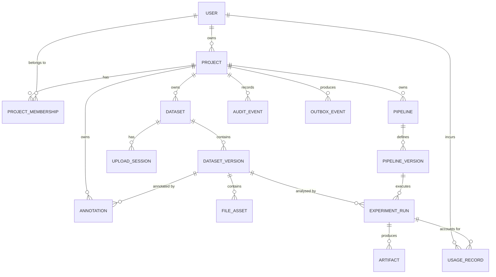
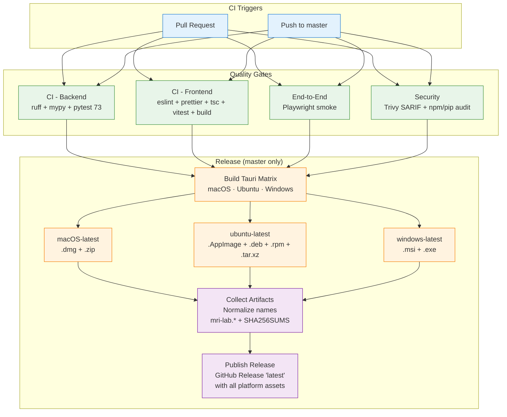

# MRI Lab


MRI Lab is a full-stack computational-neuroimaging workbench demonstration: organise projects, import MRI datasets, run reproducible image-processing pipelines, and share results inside project-scoped workspaces.

> **Research software demonstration only.** MRI Lab does not diagnose conditions, recommend treatment, or claim clinical or regulatory validity.

## Table of Contents

- [MRI Lab](#mri-lab)
  - [Table of Contents](#table-of-contents)
  - [Demo](#demo)
  - [Overview](#overview)
  - [Features](#features)
  - [Architecture](#architecture)
  - [Data Model](#data-model)
    - [Entity Relationship Diagram](#entity-relationship-diagram)
    - [Database Schema](#database-schema)
  - [Tech stack](#tech-stack)
    - [Frontend](#frontend)
    - [Backend](#backend)
    - [Async Processing](#async-processing)
    - [Storage](#storage)
    - [Ops](#ops)
  - [CI Pipeline](#ci-pipeline)
  - [Supplementary Documentation](#supplementary-documentation)
  - [License](#license)

## Demo

A screen-capture walkthrough is available at [`demo/mri-lab-demo.md`](demo/mri-lab-demo.md) (script) and [`demo/mri-lab-demo.mp4`](demo/mri-lab-demo.mp4) (recording). It demonstrates:

- Operational health: liveness, readiness, Prometheus `/metrics`
- Landing page and "private by default" positioning
- Sign-in with a development identity and an HttpOnly session cookie
- Project-scoped dashboard, workspace usage, and recent runs
- Project lifecycle: browse, create, detail, members, roles, archive
- Settings and session teardown
- Project isolation: cross-project access returns `404`, never `403`


## Overview

MRI Lab implements a complete vertical slice for computational-neuroimaging research workflows:

- **Private-by-default identity** — Development identity for local demos (no password under `AUTH_MODE=development`); production path is OIDC with HttpOnly session cookies and a route guard
- **Project workspaces** — Projects are the tenancy boundary; membership with roles (`owner`, `editor`, `viewer`) enforces write and membership-management capabilities
- **Project isolation** — Every resource is scoped to a verified project context; cross-project access is denied at the API and UI layers and returns `404`
- **Operational health** — `/health/live` and `/health/ready` endpoints plus a Prometheus `/metrics` endpoint
- **Dataset lifecycle** — Immutable dataset versions with manifests, file assets with SHA-256 checksums, resumable upload sessions
- **Asynchronous Experiment Pipelines** — Versioned pipeline definitions with image digests, durable run state (`queued`, `running`, `succeeded`, `failed`, `cancelled`), transactional outbox + dispatcher to Celery/Redis, artifacts with checksums and metadata
- **Auditability** — Immutable `audit_events` trail and idempotency keys for safe job submission

The dataset-upload workflow, the multiplanar viewer, pipeline authoring, and run execution are specified in `docs/` and summarised as **Planned** in the demo script; they are not claimed as working end-to-end yet.

## Features

| No  | Feature              | Description                                                                                |
| --- | -------------------- | ------------------------------------------------------------------------------------------ |
| 1   | Operational health   | Liveness and readiness probes, Prometheus `/metrics` endpoint                              |
| 2   | Private-by-default   | All projects and data private unless explicitly shared (`private`/`shared`/`public`)       |
| 3   | Project workspaces   | Create, list, detail, archive, restore; every resource scoped to a project                 |
| 4   | Membership and roles | Add members, change roles (`owner`/`editor`/`viewer`), last-owner invariant                |
| 5   | Session management   | Dev identity login, HttpOnly session cookie, route guard, sign-out teardown                |
| 6   | Dashboard            | Project-scoped counts, recent runs, workspace usage                                        |
| 7   | Project isolation    | Cross-project access `404` (never `403`), enforced at API and UI layers                    |
| 8   | Dataset versions     | Versioned, immutable dataset snapshots with manifests and checksummed file assets (schema) |
| 9   | Experiment pipelines | Versioned pipeline definitions, durable run states, artifacts, usage records (schema)      |
| 10  | Observability        | Structured JSON logging, request correlation IDs, health and metrics endpoints             |
| 11  | End-to-end tests     | BFF smoke suite against the live stack via Playwright                                      |

## Architecture

```text
Browser (Next.js + React + TypeScript)
        │
        ▼
Next.js BFF proxy (/api/proxy, /api/session)
        │
        ▼
FastAPI REST API ── explicit SQL ──► PostgreSQL
        │                                ▲
        │  transactional outbox          │ authoritative run state
        ▼                                │
     Redis ─────────────► Celery worker ─┘
                               │
                               └──► object storage (S3-compatible / local FS)
```

Design details live in `docs/05-architecture.md`, `docs/diagrams/architecture.md`, and `docs/diagrams/system-data-flow.md`.

## Data Model

Core entities (see `docs/database/mri-lab.dbml` and `docs/06-data-model.md` for schema):

- **Project** — Tenancy boundary; owns datasets, pipelines, runs, annotations
- **ProjectMembership** — User ↔ Project with role (`owner`, `editor`, `viewer`)
- **Dataset** — Logical dataset within a project; source type (`upload`, `import`, `sample`)
- **DatasetVersion** — Immutable snapshot with manifest (`created`, `validating`, `ready`, `failed`, `rejected`)
- **FileAsset** — Individual uploaded file with object key, SHA-256, size, media type
- **UploadSession** — Resumable upload token (`pending`, `completed`, `expired`, `aborted`); TTL bounded
- **Pipeline / PipelineVersion** — Versioned image-processing definition + image digest
- **ExperimentRun** — Durable run state (`queued`, `running`, `succeeded`, `failed`, `cancelled`), parameters, timing
- **Artifact** — Output file with checksum, media type, metadata, linked to a run
- **Annotation** — Spatial notes with explicit coordinate-space metadata
- **UsageRecord** — Per-user resource accounting
- **AuditEvent** — Immutable security-relevant action trail
- **IdempotencyKey / OutboxEvent** — Reliable, duplicate-safe job submission

All timestamps are ISO 8601 UTC; UUIDs identify resources; unknown request fields are rejected on writes.

### Entity Relationship Diagram



### Database Schema

```mermaid
erDiagram
    USERS {
        uuid id PK
        text email
        text display_name
        timestamptz created_at
    }
    PROJECTS {
        uuid id PK
        uuid owner_id FK
        text name
        text description
        enum visibility
        timestamptz created_at
        timestamptz updated_at
        timestamptz archived_at
    }
    PROJECT_MEMBERS {
        uuid project_id FK
        uuid user_id FK
        enum role
        timestamptz created_at
    }
    DATASETS {
        uuid id PK
        uuid project_id FK
        text name
        enum source_type
        timestamptz created_at
        timestamptz updated_at
        timestamptz archived_at
    }
    DATASET_VERSIONS {
        uuid id PK
        uuid dataset_id FK
        text version
        jsonb manifest
        text status
        timestamptz created_at
    }
    FILE_ASSETS {
        uuid id PK
        uuid dataset_version_id FK
        text object_key
        text checksum
        bigint size_bytes
        text media_type
        timestamptz created_at
    }
    UPLOAD_SESSIONS {
        uuid id PK
        uuid dataset_id FK
        uuid project_id FK
        enum status
        bigint expected_size_bytes
        text checksum_sha256
        timestamptz expires_at
        timestamptz created_at
    }
    PIPELINES {
        uuid id PK
        uuid project_id FK
        text name
        timestamptz created_at
        timestamptz updated_at
    }
    PIPELINE_VERSIONS {
        uuid id PK
        uuid pipeline_id FK
        text version
        jsonb definition
        text image_digest
        timestamptz created_at
    }
    EXPERIMENT_RUNS {
        uuid id PK
        uuid pipeline_version_id FK
        uuid dataset_version_id FK
        enum status
        jsonb parameters
        text error
        timestamptz started_at
        timestamptz finished_at
        timestamptz created_at
    }
    ARTIFACTS {
        uuid id PK
        uuid run_id FK
        text object_key
        text checksum
        text media_type
        jsonb metadata
        timestamptz created_at
    }
    ANNOTATIONS {
        uuid id PK
        uuid project_id FK
        uuid dataset_version_id FK
        text coordinate_space
        jsonb coordinates
        text body
        timestamptz created_at
    }
    USAGE_RECORDS {
        uuid id PK
        uuid user_id FK
        uuid run_id FK
        text resource_type
        bigint quantity
        timestamptz created_at
    }
    AUDIT_EVENTS {
        uuid id PK
        uuid actor_id FK
        text action
        text resource_type
        uuid resource_id
        timestamptz created_at
    }
    IDEMPOTENCY_KEYS {
        uuid user_id FK
        text key
        text request_hash
        jsonb response
        timestamptz created_at
    }
    OUTBOX_EVENTS {
        uuid id PK
        text event_type
        jsonb payload
        enum status
        timestamptz created_at
        timestamptz dispatched_at
    }
```



## Tech stack

### Frontend

| No  | Layer                 | Technology                                                                      | Version | Purpose                                                                  |
| --- | --------------------- | ------------------------------------------------------------------------------- | ------- | ------------------------------------------------------------------------ |
| 1   | **Framework**         | [Next.js (App Router)](https://nextjs.org/)                                     | 16.x    | React framework with server components, streaming, partial pre-rendering |
| 2   | **UI Library**        | [React](https://react.dev/)                                                     | 19.x    | Component model, hooks, concurrent features                              |
| 3   | **Language**          | [TypeScript](https://www.typescriptlang.org/)                                   | 6.x     | Strict mode, no `any`, end-to-end types                                  |
| 4   | **Styling**           | [Tailwind CSS](https://tailwindcss.com/)                                        | 4.x     | Utility-first, design tokens from `docs/09-design.md`                    |
| 5   | **Component Layer**   | [daisyUI](https://daisyui.com/)                                                 | 5.x     | Accessible, themeable components on Tailwind                             |
| 6   | **Desktop Wrapper**   | [Tauri](https://tauri.app/)                                                     | 2.x     | Native desktop app (macOS/Windows/Linux) via system WebView              |
| 7   | **State / Data**      | [TanStack Query](https://tanstack.com/query/latest)                             | 5.x     | Caching, invalidation, optimistic updates                                |
| 8   | **API Layer (BFF)**   | Next.js route handlers (`/api/proxy`, `/api/session`)                           | —       | Keeps session cookies and secrets server-side                            |
| 9   | **Testing**           | [Vitest](https://vitest.dev/), [Testing Library](https://testing-library.com/)  | —       | Unit and component tests                                                 |
| 10  | **E2E Testing**       | [Playwright](https://playwright.dev/)                                           | —       | BFF smoke tests: sign-in, route guard, tenant isolation                  |
| 11  | **Lint / Format**     | [ESLint](https://eslint.org/), [Prettier](https://prettier.io/), `tsc --noEmit` | —       | 0 errors, strict TypeScript                                              |
| 12  | **Security Scanning** | [npm audit](https://docs.npmjs.com/cli/v10/commands/npm-audit)                  | —       | CI integration, SARIF upload                                             |

### Backend

| No  | Layer                 | Technology                                                                    | Version | Purpose                                                   |
| --- | --------------------- | ----------------------------------------------------------------------------- | ------- | --------------------------------------------------------- |
| 1   | **API Framework**     | [FastAPI](https://fastapi.tiangolo.com/)                                      | 0.1xx   | Async, OpenAPI, Pydantic validation, dependency injection |
| 2   | **Language**          | [Python](https://www.python.org/)                                             | 3.14    | Type hints, `uv` package manager                          |
| 3   | **Validation**        | [Pydantic](https://docs.pydantic.dev/)                                        | 2.x     | `extra="forbid"`, custom types, model serialisation       |
| 4   | **Database Driver**   | [Psycopg](https://www.psycopg.org/psycopg3/)                                  | 3.x     | Async, prepared statements, connection pooling            |
| 5   | **Database**          | [PostgreSQL](https://www.postgresql.org/)                                     | 18      | ACID, JSONB, `FOR UPDATE SKIP LOCKED`                     |
| 6   | **Cache / Broker**    | [Redis](https://redis.io/)                                                    | 8.x     | Celery broker, dispatcher relay                           |
| 7   | **Authentication**    | JWT (HS256 dev / asymmetric or secret overrides in prod), HttpOnly cookies    | —       | `AUTH_MODE=development` vs `oidc`, session cookies        |
| 8   | **Testing**           | [pytest](https://docs.pytest.org/), [HTTPX](https://www.python-httpx.org/)    | —       | Unit, API, integration, security; real PostgreSQL         |
| 9   | **Lint / Format**     | [Ruff](https://docs.astral.sh/ruff/), [mypy](https://mypy-lang.org/) (strict) | —       | 73 tests across 11 files, 0 errors                        |
| 10  | **Security Scanning** | [pip-audit](https://pypi.org/project/pip-audit/)                              | —       | CI integration, SARIF upload                              |

### Async Processing

| No  | Layer             | Technology                          | Version | Purpose                                                  |
| --- | ----------------- | ----------------------------------- | ------- | -------------------------------------------------------- |
| 1   | **Task Broker**   | [Redis](https://redis.io/)          | 8.x     | Outbox event relay and durable queue                     |
| 2   | **Async Workers** | [Celery](https://docs.celeryq.dev/) | 5.x     | Task routing, concurrency, time limits                   |
| 3   | **Task Dispatch** | Custom Outbox Dispatcher            | —       | `FOR UPDATE SKIP LOCKED`, bounded retries, durable state |

### Storage

| No  | Layer                    | Technology                                                  | Version | Purpose                                               |
| --- | ------------------------ | ----------------------------------------------------------- | ------- | ----------------------------------------------------- |
| 1   | **Storage Adapter**      | Local FS / [S3-compatible](https://min.io/) (MinIO locally) | —       | Streaming upload, SHA-256, provider-swappable via env |
| 2   | **Scientific Computing** | [NumPy](https://numpy.org/)                                 | 2.x     | Deterministic volume processing in `app/scientific/`  |

### Ops

| No  | Layer                | Technology                                                                            | Version | Purpose                                                                          |
| --- | -------------------- | ------------------------------------------------------------------------------------- | ------- | -------------------------------------------------------------------------------- |
| 1   | **Containerisation** | [Docker](https://www.docker.com/), [Docker Compose](https://docs.docker.com/compose/) | —       | Postgres + Redis + migrate + API + worker + dispatcher + frontend; health checks |

## CI Pipeline



## Supplementary Documentation

| No  | Document                                                                                                      | Description                                                                                          |
| --- | ------------------------------------------------------------------------------------------------------------- | ---------------------------------------------------------------------------------------------------- |
| 1   | [`docs/README.md`](docs/README.md)                                                                            | Product strategy document: vision, personas, scope, user journeys, information architecture, roadmap |
| 2   | [`docs/05-architecture.md`](docs/05-architecture.md)                                                          | Module boundaries, request lifecycle, tenancy, outbox pattern, job state machine                     |
| 3   | [`docs/06-data-model.md`](docs/06-data-model.md) + [`docs/database/mri-lab.dbml`](docs/database/mri-lab.dbml) | Canonical schema and constraints                                                                     |
| 4   | [`docs/07-api-spec.md`](docs/07-api-spec.md) + [`docs/api-specs/`](docs/api-specs/)                           | REST contract, OpenAPI 3.1 contract, error envelope                                                  |
| 5   | [`docs/12-deployment.md`](docs/12-deployment.md)                                                              | Docker Compose topology, local development, production hardening, secrets, metrics, teardown         |
| 6   | [`docs/diagrams/`](docs/diagrams/)                                                                            | Mermaid diagrams: architecture, system data flow, dataset upload, experiment pipeline, CI/CD         |
| 7   | [`docs/design/`](docs/design/)                                                                                | HTML design prototype and captured screenshots                                                       |

## License

MRI Lab is released under the [MIT License](LICENSE).
