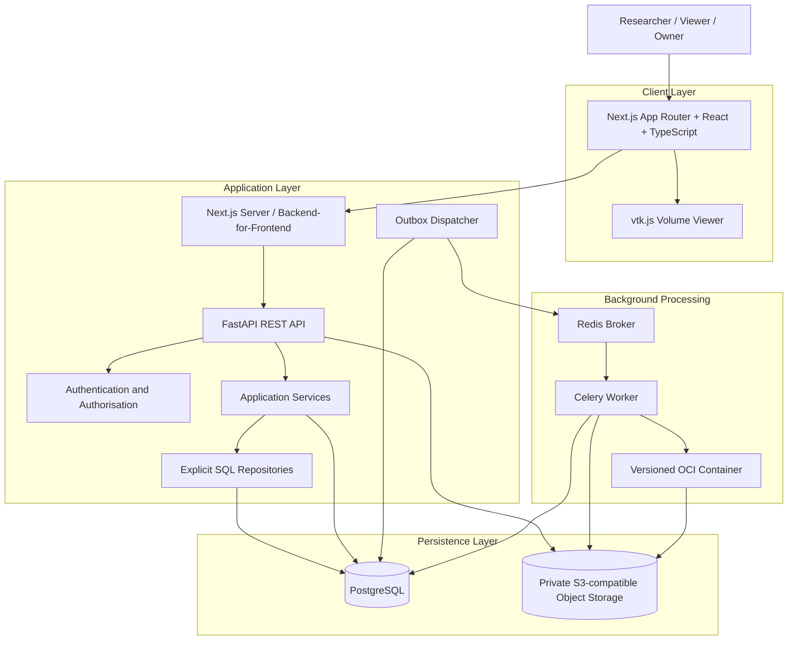
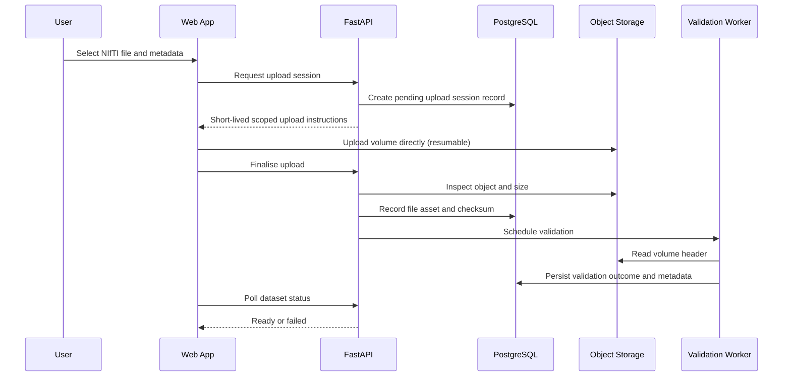

# MRI Lab — System Architecture

## 1. Purpose

This document describes the system architecture, component responsibilities, data flows, trust boundaries, and failure-recovery strategies for MRI Lab.

The architecture must support a secure neuroimaging research workflow while remaining small enough for an independently developed portfolio project.

The primary architectural goals are:

- Clear separation of responsibilities between the interactive web application and scientific computation.
- Strong project-scoped data isolation.
- Reliable asynchronous experiment execution.
- Reproducible scientific computation using versioned OCI container images.
- Safe handling of large NIfTI volumes and derived artifacts.
- Explicit, parameterised SQL with testable persistence boundaries.
- Observable failures and recoverable operations.
- Reproducible local development and deployment without requiring cloud infrastructure.

## 2. Architectural Overview

MRI Lab uses a modular monolith for its application API, with a separately deployed worker for background processing.

The frontend, API, worker, and supporting services have distinct responsibilities. The initial application must not be decomposed into many independent microservices, and must not require Kubernetes.

The main architectural rule is to separate interactive web requests from scientific computation. MRI processing must not run inside ordinary web request handlers.

### High-level architecture



The diagram shows logical responsibilities. The precise deployment topology may differ between local development and production. Metadata traffic flows through the API and PostgreSQL, volume bytes flow directly between the browser and object storage through short-lived signed URLs, and computation flows through the queue into an isolated container runtime.

The component architecture and detailed data-flow diagrams for system boundaries, dataset upload, experiment processing, and CI/CD are indexed in [`diagrams/`](diagrams/README.md).

## 3. Architectural Style

### 3.1 Modular monolith

The FastAPI service contains the application's business logic, API endpoints, and persistence integration.

Organise modules around responsibilities and domain concepts (projects, datasets, pipelines, experiment runs, artifacts) rather than creating a separate network service for every feature.

Advantages:

- Straightforward local development.
- Easier transaction management.
- Fewer deployment dependencies.
- Clearer debugging.
- Strong integration testing.
- Lower operational overhead.

### 3.2 Separate worker process

Background computation runs in a separate worker process, and the scientific code runs inside a versioned OCI container launched by that worker.

This prevents expensive image-processing operations from blocking the API event loop and allows the worker to have its own resource limits and scaling policy.

The worker shares domain and persistence modules with the API where appropriate, but it must not depend on API process memory.

### 3.3 Explicit boundaries

Keep the following boundaries clear:

- Presentation and client state.
- HTTP and API contracts.
- Application business rules.
- Persistence and SQL.
- Scientific computation and container runtime.
- External infrastructure.

A module should not need to know the implementation details of unrelated layers.

### 3.4 Why not microservices or Kubernetes

The product scope does not justify distributed complexity at this stage. A microservice fleet and Kubernetes control plane would add deployment, networking, observability, and security overhead before demand is established.

The modular monolith plus a single worker service keeps transactions local, makes cross-project isolation easier to reason about, and allows the entire stack to run through Docker Compose.

Cloud infrastructure (GCP or AWS, Terraform, Kubernetes, and split-out services) is explicitly deferred. The architecture must not require it to function, and any cloud deployment must remain an optional, documented evolution rather than a prerequisite.

If scaling or security requirements later justify splitting a component (for example notebook orchestration, public dataset ingestion, or a dedicated viewer tile service), that split must be recorded as an Architecture Decision Record before implementation.

## 4. Component Responsibilities

| Component                  | Responsibility                                                                                                                        |
| -------------------------- | ------------------------------------------------------------------------------------------------------------------------------------- |
| Frontend application       | Authentication experience, project navigation, dataset upload, metadata presentation, viewer controls, run submission and monitoring. |
| MRI viewer                 | Multiplanar slice rendering, linked crosshairs, contrast and colour maps, atlas overlays, viewer-state persistence.                   |
| Backend-for-Frontend (BFF) | Resolves the session on the server, forwards authenticated REST calls, and keeps tokens out of browser storage.                       |
| API service                | Authenticates requests, resolves the user, verifies project membership, validates input, manages metadata, and creates runs.          |
| Application services       | Coordinate complete business operations such as upload finalisation, validation, run submission, and artifact recording.              |
| SQL repositories           | Encapsulate parameterised SQL, project-scoped filters, transactions, and row-to-domain mapping.                                       |
| Scientific module          | Deterministic NIfTI reading, validation, and image operations used by workers and tests.                                              |
| Background worker          | Executes queued experiment runs, applies limits, launches containers, persists outcomes, and records safe failures.                   |
| OCI runtime                | Runs versioned container images holding NiBabel, Nilearn, SimpleITK, and ANTs for a single run in isolation.                          |
| PostgreSQL                 | Authoritative source of truth for metadata, project membership, run state, artifacts, and audit events.                               |
| Redis                      | Transports background task messages; never the authoritative source of run state.                                                     |
| Outbox dispatcher          | Publishes committed outbox events to Redis reliably, independent of the API request transaction.                                      |
| Object storage             | Holds source volumes, derived artifacts, and manifests behind private access and short-lived signed URLs.                             |

### 4.1 Frontend application

Technology: Next.js App Router, React, TypeScript.

Responsibilities:

- Authentication experience.
- Project selection and project management.
- Dataset upload and metadata presentation.
- Volume exploration.
- Pipeline selection and run submission.
- Run status monitoring and log viewing.
- Artifact presentation and download.
- Accessible error, loading, and empty states.

The frontend is not trusted to enforce permissions or validate scientific data conclusively.

Browser code talks to the Python API only through the Next.js server (Backend-for-Frontend) that runs inside the Next.js process (see `08-tech-stack.md`). The BFF reads the HttpOnly session cookie, resolves the active project on the server, and forwards authenticated REST requests; it never weakens the checks performed by the API.

Client-side validation improves usability, but the API must repeat all security-relevant checks.

### 4.2 MRI viewer

Technology: vtk.js, with Cornerstone3D evaluated for workflows it serves better.

Responsibilities:

- Render axial, coronal, and sagittal slices with linked crosshairs.
- Apply display transforms (window/level, zoom, pan, colour maps) that do not modify stored data.
- Request volumes or bounded slices from the API through signed URLs.
- Overlay compatible atlas labels.
- Persist viewer state without treating display settings as analytical parameters.

The viewer distinguishes display transformations from analytical computations. What the user sees on screen must never be recorded as the scientific input to a run.

### 4.3 API service

Technology: FastAPI and Pydantic.

Responsibilities:

- Authenticate requests.
- Resolve the current user.
- Verify project membership and permissions.
- Validate API input.
- Apply business rules.
- Manage relational metadata.
- Coordinate upload sessions and finalisation.
- Create experiment runs and outbox events.
- Issue short-lived signed URLs for authorized volume and artifact access.
- Emit structured logs.
- Expose health and readiness endpoints.

The API should remain stateless between requests, apart from appropriately managed external session mechanisms.

### 4.4 Application services

Application services implement complete business operations, such as:

- Creating a project.
- Finalising a dataset upload.
- Validating a NIfTI volume.
- Submitting an experiment run.
- Claiming or completing a run.
- Persisting artifacts and the experiment manifest.

Services coordinate repositories and external integrations.

They should not contain presentation-specific logic or rely on implicit global state.

### 4.5 SQL repositories

Repositories encapsulate explicit SQL queries and transaction boundaries.

Responsibilities:

- Reading and writing domain records.
- Applying project-scoped filters.
- Handling concurrency.
- Enforcing expected state transitions.
- Retrieving paginated results.
- Mapping database rows to application structures.

Use parameterised SQL for all user-controlled values.

Repositories must not accept a project identifier from the client as proof of authorisation. They receive a project context already verified by the application layer.

### 4.6 Scientific module

Technology: Python, NiBabel, Nilearn, SimpleITK, and ANTs where needed, packaged inside versioned container images.

Responsibilities:

- Load supported NIfTI data within configured limits.
- Validate image arrays, headers, affine transforms, and coordinate conventions.
- Compute image operations such as thresholding, smoothing, resampling, and masking.
- Return typed, serialisable results and artifact metadata.
- Apply documented numerical and coordinate conventions.
- Avoid modifying source data in place.

Keep numerical functions as deterministic and independently testable as practical.

### 4.7 Background worker

Technology: Celery backed by Redis.

Responsibilities:

- Execute queued experiment runs.
- Load authorised run inputs.
- Launch the correct versioned container image by digest.
- Apply resource and time limits.
- Persist successful artifacts and the manifest.
- Record safe failure information.
- Retry eligible transient errors.
- Recover from interrupted execution.

A worker must verify the current run state before committing results. Receiving a duplicate message must not automatically mean the run can execute again.

### 4.8 PostgreSQL

PostgreSQL is the source of truth for application metadata and run state.

It stores relational records, ownership relationships, lifecycle state, artifacts metadata, audit events, and experiment manifests. Voxel arrays are never stored in relational rows; they live in object storage.

### 4.9 Redis

Redis transports background task messages.

It is not the authoritative source of run state. The application must be able to inspect run status from PostgreSQL even when Redis is temporarily unavailable.

### 4.10 Object storage

Private S3-compatible object storage holds NIfTI source volumes and processing artifacts. MinIO is used locally.

Store object keys and metadata in PostgreSQL. Do not store public URLs as a substitute for access control, and do not treat possession of an object key as authorisation.

## 5. Repository and Module Boundaries

MRI Lab is a pnpm workspace rooted at `@mri-lab/workspace`.

```text
mri-lab/
├── package.json               # @mri-lab/workspace (private root)
├── pnpm-workspace.yaml        # packages/*
├── docker-compose.yaml
├── packages/
│   ├── frontend/              # @mri-lab/web
│   └── backend/
└── docs/
```

The frontend package is published internally as `@mri-lab/web` and contains the Next.js application and viewer.

A suggested backend structure:

```text
packages/backend/
├── app/
│   ├── api/
│   │   ├── dependencies.py
│   │   ├── errors.py
│   │   └── routes/
│   │       ├── auth.py
│   │       ├── projects.py
│   │       ├── datasets.py
│   │       ├── volumes.py
│   │       ├── pipelines.py
│   │       ├── runs.py
│   │       └── artifacts.py
│   ├── core/
│   │   ├── config.py
│   │   ├── logging.py
│   │   ├── security.py
│   │   └── exceptions.py
│   ├── db/
│   │   ├── connection.py
│   │   ├── session.py
│   │   └── migrations/
│   ├── models/
│   │   ├── project.py
│   │   ├── dataset.py
│   │   ├── pipeline.py
│   │   ├── run.py
│   │   └── artifact.py
│   ├── schemas/
│   │   ├── common.py
│   │   ├── project.py
│   │   ├── dataset.py
│   │   ├── pipeline.py
│   │   └── run.py
│   ├── repositories/
│   │   ├── projects.py
│   │   ├── datasets.py
│   │   ├── pipelines.py
│   │   ├── runs.py
│   │   └── artifacts.py
│   ├── services/
│   │   ├── projects.py
│   │   ├── uploads.py
│   │   ├── validation.py
│   │   ├── volumes.py
│   │   └── runs.py
│   ├── scientific/
│   │   ├── nifti.py
│   │   └── images.py
│   ├── storage/
│   │   └── objects.py
│   └── main.py
├── workers/
│   ├── celery_app.py
│   ├── dispatcher.py
│   └── run_tasks.py
├── tests/
└── pyproject.toml
```

A suggested frontend structure:

```text
packages/frontend/
├── app/
│   ├── (auth)/
│   ├── projects/
│   ├── viewer/
│   └── api/                  # BFF route handlers
├── components/
├── lib/
├── public/
└── package.json              # @mri-lab/web
```

This is a proposed organisation. Keep the codebase simpler if a module does not yet justify its own file.

Avoid circular imports and avoid importing API route handlers into business logic.

## 6. Request Lifecycle

For a protected API request:

Browser-originated requests first reach the Next.js Backend-for-Frontend, which authenticates the caller from the HttpOnly session cookie and resolves the project context before forwarding a REST request to the Python API. The steps below describe the Python API that ultimately serves the data.

1. The frontend sends an HTTP request.
2. The API validates the request format.
3. Authentication identifies the caller.
4. The application resolves the relevant project context.
5. The server verifies membership and role permissions.
6. The application service executes the requested operation.
7. Repositories perform parameterised SQL operations as required.
8. External services are called only when needed.
9. The API constructs an explicit response model.
10. Structured logs capture the outcome and request identifier.

For state-changing requests, database transactions must protect the relevant invariants.

This synchronous path handles metadata and authorisation. It must not perform MRI processing. Requests that would trigger computation create a durable run record and an outbox event instead, then return promptly.

## 7. Project Isolation and Multi-Tenancy

Project isolation is a fundamental security boundary. MRI Lab uses project-scoped tenancy: `projects` is the top-level workspace, and `project_members` defines who may act within it.

### 7.1 Trusted identity

The server obtains the user identity from the verified authentication mechanism.

It must not trust a client-supplied user ID as proof of identity.

### 7.2 Membership verification

Before accessing a project-scoped resource, the server verifies that the authenticated user has an appropriate `project_members` role.

### 7.3 Resource scoping

For a dataset volume belonging to a project, the application must verify the relationship between:

- Authenticated user.
- Project membership.
- Project.
- Dataset and dataset version.
- File asset.
- Requested operation.

Checking only that the dataset ID exists is insufficient.

### 7.4 Defence in depth

Use:

- Server-side authorisation.
- Explicit project-scoped queries.
- Database constraints on foreign keys and membership.
- Tests using multiple projects and users.
- Carefully controlled service credentials.
- Optional database row-level security if implemented and tested correctly.

### 7.5 Object-key possession is not authorisation

Object storage keys, signed URLs, and file names are not credentials. Every read, write, download, and job submission checks the caller's permissions against project membership, even when the caller already knows an object key.

Signed URLs are issued only after an authorisation check, are short-lived, are scoped to a single object, and do not grant listing or overwrite rights.

### 7.6 Cache isolation

Project-specific caches must be keyed by the appropriate project and user context.

When the active project changes, the frontend must invalidate relevant cached data.

A cache hit must never bypass a permission check that is required for the operation.

## 8. Dataset Upload Architecture

Large NIfTI volumes should not routinely pass through several layers of application memory. Uploads use upload sessions and direct-to-object-storage transfer.

### Recommended flow



This sequence is conceptual. The initial implementation may perform lightweight validation synchronously if the file limits make that safe, but large or expensive validation must use the worker.

### Upload invariants

- The user must be authorised to upload into the target project.
- Storage is private.
- The server validates the file independently of browser checks.
- The dataset version is not ready before validation succeeds.
- Completion validation confirms the object exists, matches the declared size, and has the expected checksum.
- Finalisation must be idempotent or protected against duplicate requests, using `idempotency_keys` where required.
- Interrupted uploads can be identified and cleaned up.
- A database failure after object upload must not create an indefinitely invisible object.
- Upload sessions and signed URLs must expire.
- File-size and parser limits must be enforced.

### Checksums and completion

When an upload session is created, the client declares the expected size and, where available, a content checksum. On completion the server verifies:

1. The object exists at the recorded key.
2. The stored size matches the declared size.
3. The checksum matches, or the server computes and records a SHA-256 checksum if the client did not supply one.
4. The object is registered as a `file_assets` row linked to a draft `dataset_version`.

Only then is validation scheduled and the dataset version marked ready.

### Upload recovery

Use an explicit lifecycle and reconciliation process.

For example, an object may exist while the database still records a pending upload session. A scheduled cleanup or reconciliation task should detect abandoned sessions and unreferenced objects according to a documented retention policy.

Do not delete source volumes merely because a transient database operation failed.

## 9. NIfTI Validation and Metadata Extraction

NIfTI is the initial imaging format because it provides standardised image data and spatial-coordinate metadata. Validation protects the platform from malformed headers and resource-exhaustion attacks, and it is the foundation of correct spatial interpretation.

Validation extracts and records:

- Header validity and NIfTI version (`nifti1` or `nifti2`).
- Dimensions (rank and per-axis sizes).
- Voxel spacing (pixdim).
- Orientation and axis directions (qform/sform and orientation codes).
- Data type and bit depth.
- The affine transformation matrix linking voxel indices to world coordinates.
- Coordinate conventions applied (for example RAS+ versus other conventions).
- Scaling parameters (`scl_slope`, `scl_inter`) and units.
- Whether the layout is compressed (`.nii.gz`) and the decompressed size.

Validation rules:

1. Reject files that are not valid NIfTI or that fail header parsing.
2. Enforce maximum dimensions, rank, and decompressed size to bound memory and time.
3. Guard against decompression bombs and malformed headers before reading array data.
4. Verify that the affine is finite and invertible before relying on it.
5. Record checksums and provenance for reproducible reference.
6. Treat validation as read-only; never mutate the source volume.

Validation outcomes are persisted as structured metadata so the frontend can present dimensions, spacing, orientation, and data type, and so experiment runs can record the exact coordinate conventions used.

## 10. MRI Viewer Data Path

The viewer needs interactive access to volume data without routing large arrays through the API event loop.

### Volume access strategy

- The API authorises the request and issues a short-lived, single-object signed URL for the dataset version's file asset.
- The browser fetches the volume directly from object storage through the signed URL.
- The viewer performs slicing client-side using vtk.js.
- The API never streams full voxel arrays through its own memory as a general-purpose path.

Where a derived representation (for example a downsampled preview or a pre-computed mosaic) is needed, it is generated asynchronously by the worker and stored as an artifact, then delivered through the same signed-URL mechanism.

### Slicing

The viewer requests or derives axial, coronal, and sagittal slices and keeps their crosshairs linked. Slice index, window/level, zoom, pan, and colour map are display state.

### Viewer-state persistence

Viewer state such as camera position, selected slice, crosshair coordinates, window/level, and overlays may be persisted as user or project preferences.

Viewer-state persistence must not be treated as input to an experiment run. Only the recorded dataset version, pipeline version, and explicit parameters define a run.

### Atlas overlays

Compatible atlases can be toggled as overlays. Atlas data is either bundled or stored as a referenced asset with its own coordinate-space metadata. The viewer must state which coordinate space an overlay uses so that labels are not misattributed.

### Display transforms vs analytical computations

The architecture distinguishes:

- Display transforms, which affect rendering only.
- Analytical computations, which affect scientific results and must run in the worker inside a versioned container.

The same operation may exist in both forms, but a display-only operation must never be presented as a recorded analysis.

## 11. Experiment Run Architecture

### 11.1 Purpose and versioning

An experiment run executes a versioned pipeline against a versioned dataset.

- A `pipeline` is the logical analysis workflow.
- A `pipeline_version` holds the definition and the `image_digest` of the OCI container that implements it.
- An `experiment_run` references a `pipeline_version_id`, a `dataset_version_id`, validated `parameters`, and status.

Pinning `image_digest` ensures a run resolves to exact container contents rather than a mutable tag.

### 11.2 Job submission

The API validates the request and creates a durable run record.

The record includes:

- Run ID.
- Project ID.
- Dataset version ID.
- Pipeline version ID and image digest.
- Validated parameters.
- Requested-by user ID.
- Idempotency information where applicable.
- Current state.
- Timestamps.

The API returns the run resource without waiting for computation to finish. A non-null `idempotency_keys` entry prevents duplicate run creation from retried submissions.

### 11.3 Dispatch reliability

A naive sequence of committing a run to PostgreSQL and then publishing a Redis message has a failure window: the database transaction may succeed while queue publication fails.

Use a transactional outbox. Create the run and its `outbox_events` row in the same database transaction, commit both, then let the dispatcher publish pending events. This is described further in section 13.

### 11.4 Worker execution

The worker:

1. Receives a run identifier.
2. Loads the run from PostgreSQL.
3. Checks that its state permits execution.
4. Claims the run using a concurrency-safe transition.
5. Resolves the pipeline version and container `image_digest`.
6. Loads authorised input volumes via object storage.
7. Executes the container with the validated parameters.
8. Validates the output.
9. Persists artifacts and the experiment manifest.
10. Marks the run successful in the appropriate transaction.
11. Emits structured operational logs.

If a failure occurs, the worker records an appropriate state and classifies whether retry is safe.

### 11.5 Worker isolation and resource limits

- Each run executes inside an isolated OCI container launched by the worker.
- Containers run with no default access to application secrets, the database, or other users' files.
- CPU, memory, disk, wall-clock runtime, and egress are bounded.
- Worker egress is restricted; access to cloud metadata endpoints and internal services is blocked.
- Inputs are provided through a controlled, read-only mechanism; outputs are written to a controlled location and then stored as artifacts.

### 11.6 Concurrency

Do not allow multiple workers to commit competing results for the same logical run.

Use a conditional state update, row locking, a lease, or another explicitly tested concurrency mechanism.

A worker that discovers the run has already completed should exit without changing its result.

### 11.7 Retries

Use bounded retries with exponential backoff and jitter for transient failures.

Do not automatically retry invalid input, unsupported formats, or deterministic scientific computation errors without a clear reason.

Define what happens when the retry limit is reached.

### 11.8 Stale runs

Implement a recovery strategy for runs left in `running` after a worker crash.

A lease or heartbeat can distinguish active processing from stale ownership.

Recovery must avoid restarting work that is still executing elsewhere.

### 11.9 Logs

Run logs are captured separately from application logs, are authorised like other project resources, and must not contain secrets, signed URLs, or unrelated users' data.

## 12. Result Persistence and Reproducibility

An experiment result must be linked to the exact input and computation that produced it.

Every successful run produces a machine-readable experiment manifest alongside its artifacts. The manifest records:

- Schema version.
- Run ID.
- Pipeline name, version, and `image_digest`.
- Input dataset versions and their checksums.
- Parameters, including coordinate conventions and relevant random seeds.
- Environment description and software versions.
- Output artifact references and checksums.
- Status.

Persist the manifest, artifacts, and successful terminal run state consistently.

If artifact persistence fails, the run must not appear successful.

Artifacts are recorded in the `artifacts` table with `object_key`, `checksum`, `media_type`, and metadata. Record SHA-256 checksums for uploaded source volumes and derived artifacts so a run's outputs can be verified.

If an artifact is stored in object storage, account for the lack of a shared transaction between PostgreSQL and object storage. Use a staged write and finalisation process, or another documented recovery mechanism.

Historical results should not be silently overwritten by later runs.

## 13. API and Worker Separation

The API and worker share domain logic and persistence modules, but run as separate processes.

### API process

Optimise for:

- Request latency.
- Network I/O.
- Bounded database access.
- Predictable concurrency.
- Fast validation.

### Worker process

Optimise for:

- CPU and memory limits.
- Numerical computation.
- Long-running container execution.
- Retry and recovery behaviour.
- Processing throughput.

Do not start a Celery worker inside the FastAPI process or rely on background tasks that disappear when the API process restarts for work that must be durable.

### Transactional outbox

The API never publishes a queue message directly inside a request in a way that can diverge from committed database state.

With an outbox:

1. Create the run and an `outbox_events` row in the same database transaction.
2. Commit both.
3. A dispatcher publishes pending outbox events to Redis.
4. The dispatcher marks an event as published only after successful delivery.
5. Repeated publication remains safe because worker processing is idempotent.

The dispatcher may run as a dedicated component deployed alongside the worker. If it crashes, unpublished events remain in PostgreSQL and are retried. If Redis is unavailable, dispatch is delayed but accepted runs remain visible and correct.

## 14. Database Transactions and Integrity

Use PostgreSQL transactions for operations that must be atomic within the relational database.

Examples:

- Creating a project and related initial records.
- Creating a run and its outbox event.
- Persisting artifacts and marking the run successful.
- Updating membership and recording the corresponding audit event.
- Finalising an upload session and creating the file asset.

Use constraints for invariants that should remain true regardless of which application code path performs a write, including foreign keys from datasets to projects and from runs to dataset versions and pipeline versions.

Do not assume that a successful object-storage operation can be rolled back by a PostgreSQL transaction.

Use compensating operations and reconciliation where multiple services participate in a workflow.

Use Psycopg 3 with an async connection pool and explicit SQL. Repositories own transaction boundaries and must not leave implicit or long-lived transactions open across network calls.

## 15. Authentication Architecture

The authentication implementation must be chosen and documented before production deployment.

MRI Lab expects a managed OpenID Connect-compatible identity provider.

Acceptable approaches include:

- A managed OpenID Connect provider.
- A carefully implemented server-side session system.
- Another maintained authentication solution with clear security properties.

Do not build a custom password-management system merely to avoid selecting an authentication provider.

The architecture must document:

- Identity verification.
- Session lifecycle.
- Cookie or token storage.
- CSRF protection where applicable.
- CORS configuration.
- Logout behaviour.
- Membership revocation.
- Local development authentication.
- Production identity configuration.

Prefer secure, HttpOnly cookies for browser sessions when the chosen authentication architecture supports them appropriately. The BFF holds the session cookie and forwards authenticated REST requests; tokens are not exposed to client-side JavaScript.

Never store long-lived credentials in browser local storage.

Project membership revocation must take effect for new requests promptly and must not be bypassed by cached frontend state.

## 16. External Service Boundaries

Wrap external integrations behind small interfaces where this improves testability.

Examples:

- `ObjectStorage`: create upload sessions, inspect objects, issue signed URLs, read, and delete objects.
- `RunDispatcher`: publish or schedule a durable run.
- `AuthenticationProvider`: validate identity or resolve a session.
- `ContainerRuntime`: launch a versioned image with explicit limits.
- `Clock`: provide deterministic time in tests where useful.

Do not introduce a generic plugin framework or extensive dependency-injection system without a concrete need.

The goal is to make infrastructure replaceable and testable without hiding the important application behaviour. The object storage abstraction must allow a local MinIO deployment and an S3-compatible production service to be used interchangeably.

## 17. Observability

### Structured logs

Include fields such as:

- Timestamp.
- Severity.
- Service name.
- Request or run ID.
- Operation.
- Outcome.
- Error classification.
- Duration.
- Project identifier where safe.

### Metrics

Track useful operational measurements:

- Request latency.
- API error rate.
- Database connection utilisation.
- Upload completion and failure rates.
- Queue depth.
- Run execution duration.
- Run retry count.
- Run failure rate.
- Stale run count.
- Container resource usage per run.

### Error tracking

Unexpected errors are captured with enough context to investigate a failure without exposing secrets or raw volume data.

### Run status

Run status is readable from PostgreSQL at all times: `queued`, `running`, `succeeded`, `failed`, or `cancelled`. The frontend polls or subscribes to status and shows the failure reason and authorized logs.

### Correlation

A run should retain enough context to correlate its API submission, dispatch, worker execution, container invocation, and artifact persistence.

Do not put secrets, access tokens, signed URLs, or raw voxel data in logs.

## 18. Deployment Architecture

### Local development

Use Docker Compose for PostgreSQL, Redis, MinIO (S3-compatible object storage), and any supporting local services.

Run the frontend, API, and worker using documented commands or containers.

The development setup must not require access to production credentials.

### CI

GitHub Actions runs the quality gate: frontend lint, typecheck, and tests; backend lint, typecheck, and tests; and container builds. Husky and lint-staged apply fast formatting and lint checks to staged backend and frontend source files locally; CI remains the authoritative full validation.

### Deployment evolution

Initial deployment is a single environment defined by `docker-compose.yaml`, running:

- Next.js frontend.
- FastAPI API.
- Celery worker.
- Outbox dispatcher.
- PostgreSQL.
- Redis.
- S3-compatible object storage.

Cloud infrastructure (GCP or AWS via Terraform, Kubernetes, and split-out microservices) is explicitly deferred and must not be required for the platform to build, test, or run. Any future cloud deployment is documented as an optional evolution and must preserve the security and isolation properties described here.

## 19. Failure Scenarios

| Failure                           | Expected behaviour                                                              |
| --------------------------------- | ------------------------------------------------------------------------------- |
| PostgreSQL unavailable            | Requests requiring database access fail safely; readiness reports unavailable   |
| Redis unavailable                 | Run dispatch is delayed or retried; accepted runs remain visible in PostgreSQL  |
| Outbox dispatcher crashes         | Unpublished events remain committed and are retried on restart                  |
| Worker crashes                    | Run recovery identifies stale execution and safely retries eligible work        |
| Container runtime unavailable     | Run fails with a clear terminal state; no partial result is marked successful   |
| Object storage unavailable        | Upload or retrieval fails clearly; metadata remains consistent                  |
| Upload interrupted                | Upload remains incomplete and can be resumed, retried, or cleaned up            |
| Checksum mismatch on completion   | Upload is rejected and the dataset version is not made ready                    |
| Artifact write fails              | Run is not marked successful and the manifest is not published as complete      |
| Duplicate task delivered          | Worker state checks prevent conflicting duplicate results                       |
| Session expires                   | User is asked to re-authenticate or renew the session                           |
| Project membership revoked        | Protected operations are denied after revocation takes effect                   |
| Malformed NIfTI upload            | Validation rejects it with a structured, understandable error                   |
| Frontend request becomes obsolete | Cancellation or request identity prevents stale results replacing current state |

## 20. Security Boundaries

Treat these as separate trust zones:

1. Browser and client-controlled state.
2. Authenticated API.
3. Relational database.
4. Object storage.
5. Message broker.
6. Background worker.
7. Isolated OCI container runtime.
8. Optional cloud control plane.

Security requirements:

- Validate all external input.
- Authenticate before protected access.
- Authorise each resource operation against project membership.
- Never treat an object key or signed URL as authorisation.
- Use least-privilege service identities and short-lived credentials.
- Restrict network access to internal services and block cloud metadata endpoints from containers.
- Use TLS for external service communication.
- Protect secrets and signing credentials.
- Bound CPU, memory, disk, file sizes, and execution time.
- Keep uploaded files non-executable and validate their headers with bounds.
- Never execute uploaded code outside the isolated container runtime.
- Avoid leaking data through logs, error responses, caches, or object URLs.
- Provide clear deletion semantics for source data, derived files, cached copies, and backups.

Uploaded clinical data and arbitrary analysis code are treated as separate threat models. Private-by-default applies to all datasets and artifacts.

## 21. Architecture Decision Records

Document significant decisions under `docs/decisions/`.

At minimum:

- Authentication provider and session model.
- Datasets and versions API (session-based, resumable, direct-to-object-storage uploads).
- Upload validation strategy, checksums, and completion validation.
- Background job architecture (Celery, Redis, and transactional outbox).
- Viewer and rendering choice (vtk.js, with Cornerstone3D evaluation).
- daisyUI component layer for the frontend design system.
- Object storage abstraction (MinIO locally, S3-compatible in production).
- Explicit SQL and repository boundaries.
- Worker hosting, container runtime, and image digest pinning.
- Project isolation strategy.
- Deployment topology and the deferred cloud evolution.

Each record should state the context, decision, alternatives, consequences, and criteria for reconsideration.

## 22. Architecture Definition of Done

The architecture is implemented when:

1. The API and worker run independently, and MRI processing never runs inside a web request handler.
2. The application has explicit module boundaries within the pnpm workspace (`@mri-lab/workspace`, `@mri-lab/web`, and `packages/backend`).
3. Project isolation is enforced and tested, and object-key possession is never treated as authorisation.
4. PostgreSQL is authoritative for metadata, run state, and results.
5. Background task dispatch has a documented reliability strategy using the transactional outbox.
6. Duplicate task delivery cannot corrupt results.
7. Large NIfTI volumes are uploaded directly to object storage and validated with checksums and bounded header parsing.
8. NIfTI metadata (dimensions, spacing, orientation, data type, affine, and coordinate conventions) is extracted and preserved.
9. Runs execute inside versioned OCI containers pinned by `image_digest`, with explicit resource limits.
10. Viewer display transforms are distinguished from analytical computations.
11. Source data and result provenance are preserved through a machine-readable experiment manifest.
12. Cross-service failure recovery is documented and tested.
13. Structured logging and run status support investigation without exposing secrets.
14. Secrets and private volumes are protected, and private-by-default sharing is enforced.
15. Local development and deployment follow documented architecture using Docker Compose and GitHub Actions, with cloud infrastructure explicitly optional.
