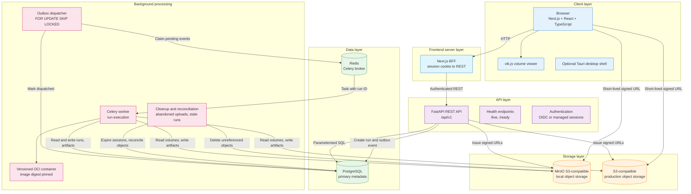
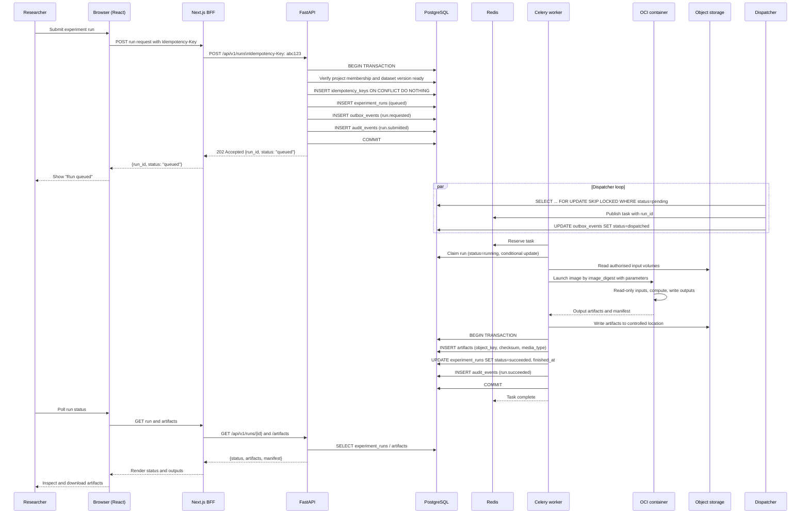
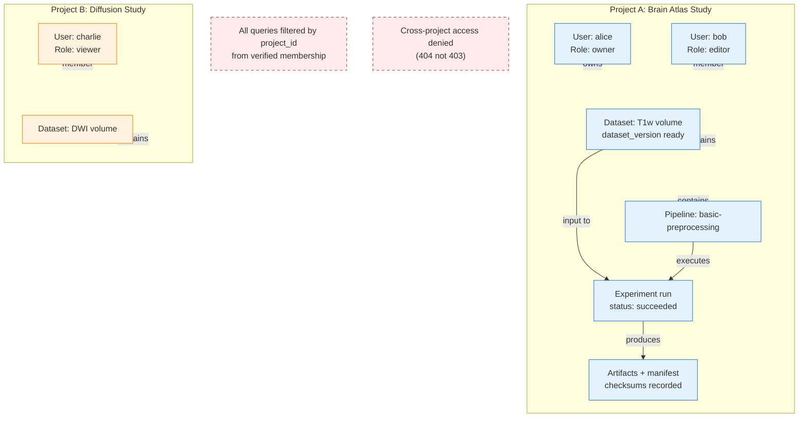
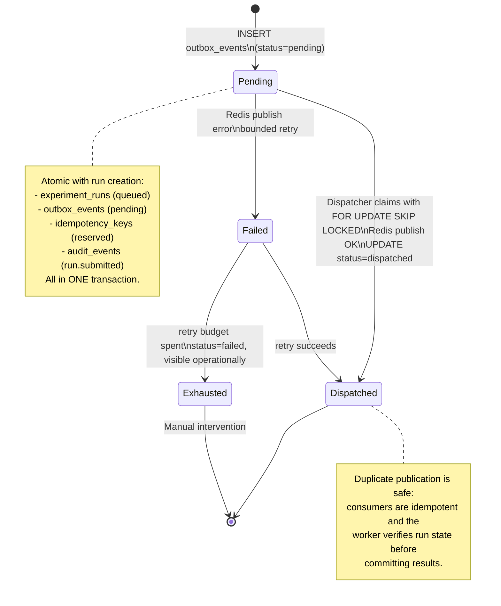
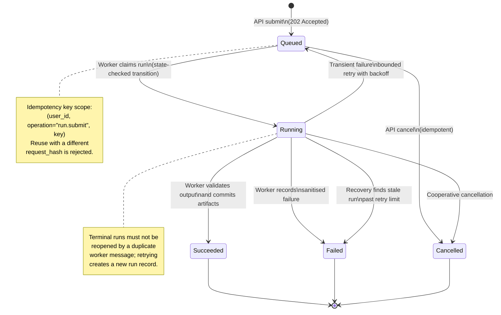
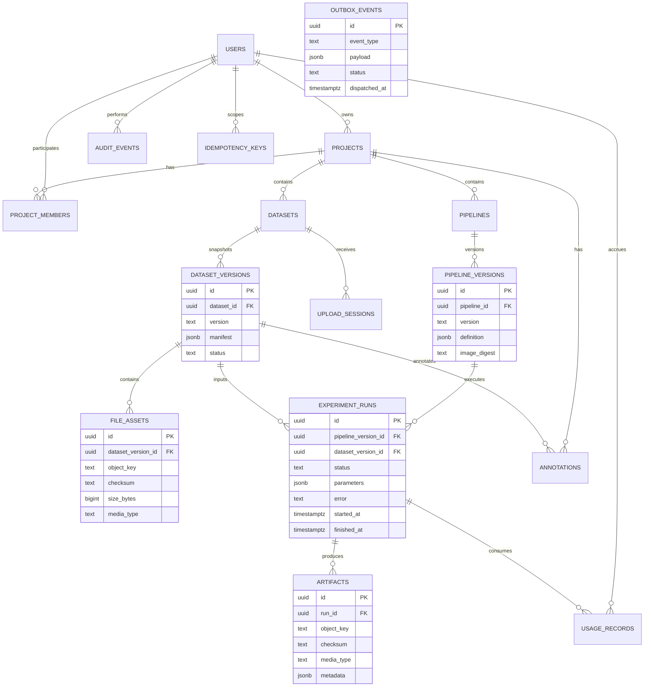
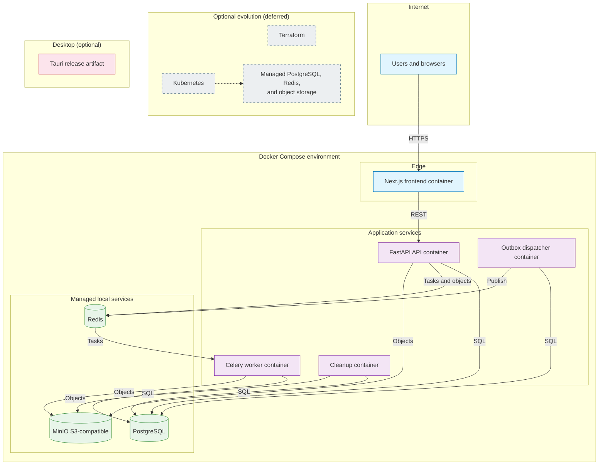

# Comprehensive Architecture and Data-Flow Diagrams

This document collects the Mermaid diagrams that describe MRI Lab's
architecture end to end. Render them with any Markdown viewer that supports
Mermaid (GitHub, GitLab, VS Code with an extension, and similar).

The canonical rule throughout is that interactive web requests are separated
from scientific computation: MRI processing never runs inside a request handler.

## 1. High-level system architecture

## 2. Request lifecycle (experiment run submission)

The browser never calls FastAPI directly: it calls the Next.js BFF route
handlers, which forward authenticated REST requests. The API creates a durable
run and its outbox event in one transaction, then returns promptly.

## 3. Project isolation model

Project isolation is a security boundary enforced in the API, in project-scoped
SQL, and through composite foreign keys. Object-key possession is never
authorisation.

## 4. Transactional outbox (reliable dispatch)

The API never publishes a queue message in a way that can diverge from committed
database state. Run creation and its outbox event are committed together.

## 5. Experiment run state machine

## 6. Data model relationships

The canonical schema is defined by versioned migrations under
`packages/backend/app/db/migrations/`. The full column-level definition lives in
[`../05-data-model.md`](../05-data-model.md).

## 7. Deployment architecture

Initial deployment is a single environment defined by `docker-compose.yaml`.
Cloud infrastructure (GCP or AWS, Terraform, Kubernetes) is explicitly deferred
and must not be required to build, test, or run the platform.

---

_Diagrams rendered with Mermaid. For interactive viewing, open in GitHub,
GitLab, or VS Code with a Mermaid extension._
