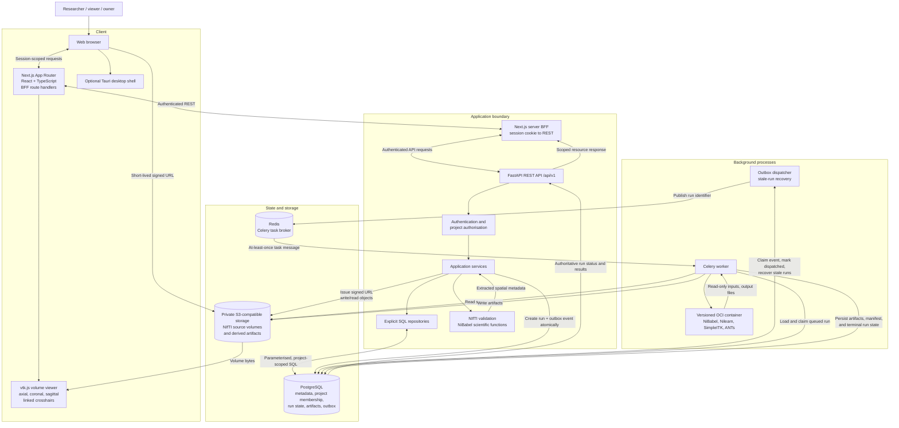

# MRI Lab Architecture

This logical architecture shows the application boundaries and runtime
dependencies. The API is a modular monolith; the Celery worker and outbox
dispatcher run as separate processes. PostgreSQL owns durable state, Redis
transports task messages, private S3-compatible object storage holds NIfTI
volumes and artifacts, and scientific computation runs inside a versioned OCI
container pinned by image digest.

## Boundary notes

- The browser can present project and resource identifiers, but the API derives
  the authenticated identity and verifies `project_members` role before
  authorising access.
- The browser talks to the Python API only through the Next.js BFF, which reads
  the HttpOnly session cookie, resolves the active project on the server, and
  forwards authenticated REST requests; it never bypasses API authorisation.
- Volume bytes move directly between the browser and private object storage
  through short-lived, single-object signed URLs. The API never streams full
  voxel arrays through its own memory as a general-purpose path.
- The dispatcher publishes only a run identifier; it never places voxel data,
  artifacts, or secrets in Redis.
- The worker reloads run, dataset-version, and pipeline-version state from
  PostgreSQL and launches the versioned container by `image_digest`. Duplicate
  messages do not make Redis the source of truth.
- Scientific computation runs only inside the versioned OCI container launched
  by the worker, never inside an API request handler.
- PostgreSQL and object storage do not share a transaction; staged writes and
  reconciliation keep metadata and stored objects consistent.
