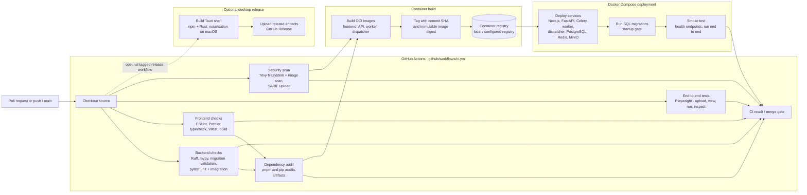

# CI/CD Pipeline

This diagram describes the GitHub Actions quality gate for MRI Lab. The workflow
runs on pull requests and pushes to `main`; CI remains the authoritative full
validation while local Husky and lint-staged hooks apply fast formatting and
lint checks to staged files. Successful builds produce container images used by
the Docker Compose deployment. A separate, optional workflow produces a Tauri
desktop release.

**Separation of concerns:** the GitHub Actions workflow validates the change and
builds versioned images; it does not deploy. The Docker Compose environment is
started for the E2E and smoke stages from the freshly built images, with
migrations applied as a startup gate. The optional Tauri release runs only from
an explicit release workflow or tag, consuming the already-tested frontend
build. Cloud deployment remains deferred and is not part of this pipeline.