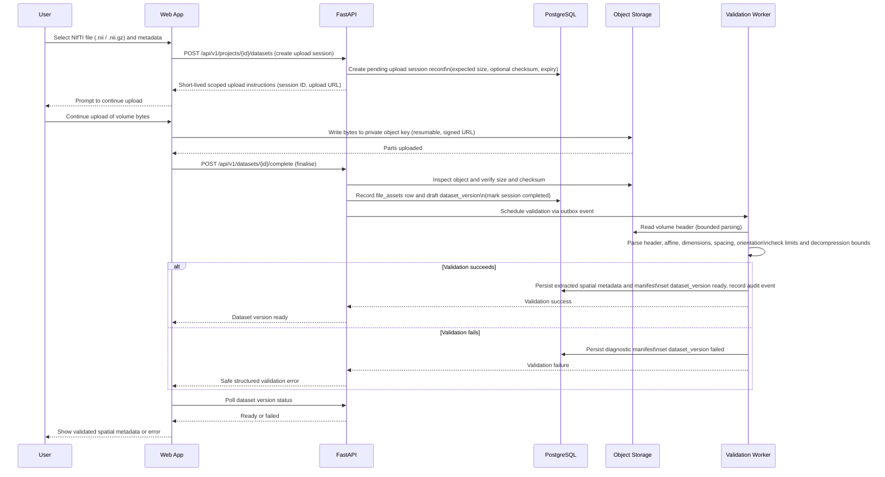

# Dataset Upload and Validation Data Flow

The NIfTI upload is resumable and direct-to-object-storage. Session creation,
finalisation, and validation are API operations executed through the Next.js
BFF. The browser uploads volume bytes directly to a short-lived, scoped signed
URL rather than streaming them through application memory. Finalisation
verifies the object, then validation is scheduled asynchronously or, for small
files, performed synchronously within limits.

## Upload invariants

- The user must be authorised to upload into the target project via
  `project_members`.
- Storage is private; the object key is a server-generated path, not a public
  URL.
- The server validates the file independently of browser-side checks.
- The dataset version is not `ready` before validation succeeds.
- Finalisation confirms the object exists, matches the declared size, and has
  the expected SHA-256 checksum (or the server computes one).
- Finalisation is idempotent or protected against duplicate requests using
  `idempotency_keys`.
- Interrupted uploads remain resumable and abandoned sessions are reconciled by
  a cleanup task.
- Upload sessions and signed URLs expire.
- File-size, dimension, rank, decompressed-size, and parser limits are
  enforced.

This path uses the outbox only for validation dispatch when validation is
asynchronous; it never runs MRI processing inside a request handler.