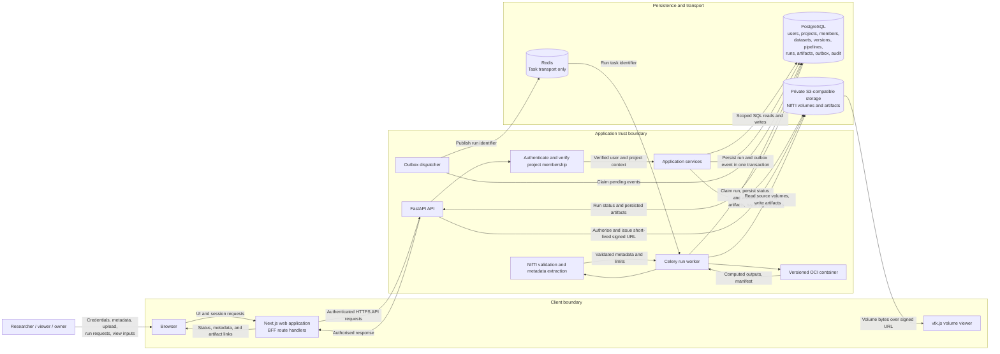

# System Data Flow

This Level 0/1 data-flow view identifies the main actors, processes, data
stores, and external transports. Project membership and resource access are
verified by the API; the browser is not an authority for access. The browser
talks to the Python API only through the Next.js BFF, which forwards
authenticated REST requests.

Redis carries task notifications only and is never the authoritative source of
run state. PostgreSQL stores the authoritative run lifecycle; volumes and
artifacts stay in private storage and are referenced by object key, checksum,
and validated metadata. Scientific computation happens only inside the versioned
container launched by the worker, never inside a request handler.