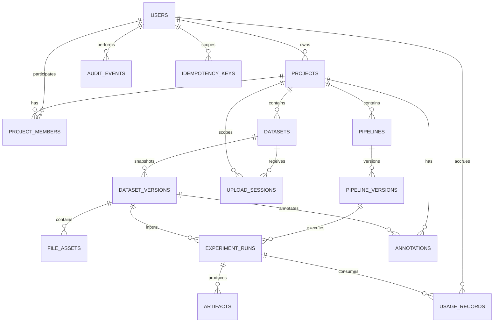

# MRI Lab — Data Model and Database Schema

## 1. Purpose

This document defines MRI Lab's relational data model, entity relationships, PostgreSQL constraints, indexes, lifecycle rules, and data-integrity requirements.

The data model must support:

- User identity and project-level access control.
- Project workspaces that own datasets, pipelines, and annotations.
- Logical datasets separated from immutable dataset versions.
- Resumable upload sessions for `.nii` and `.nii.gz` volumes.
- Asynchronous, reproducible image-processing runs.
- Versioned pipeline definitions and pinned container images.
- Output artifacts with checksums and provenance.
- Explicit spatial annotations with a declared coordinate space.
- Usage accounting, audit events, idempotent operations, and reliable job dispatch.

PostgreSQL is the authoritative source for application metadata, job state, access control, and provenance. Large scientific payloads — MRI voxel arrays, derived volumes, and reports — are stored in private S3-compatible object storage. MRI voxel arrays must never be stored in relational rows.

## 2. Data Modelling Principles

1. Use UUID primary keys for externally exposed resources so identifiers are non-guessable.
2. Separate a dataset's logical identity from its immutable `dataset_versions`.
3. Store SHA-256 checksums for uploaded files and derived artifacts.
4. Version pipeline definitions and record the container `image_digest` for every run.
5. Store annotations with an explicit `coordinate_space`; never persist three unlabelled numbers.
6. Use database transactions for state changes and idempotency keys for job submissions.
7. Enforce project access in both the API and the database layer.
8. Use foreign keys and database constraints for important invariants.
9. Persist times as UTC `TIMESTAMPTZ` values.
10. Store validated scientific metadata explicitly rather than inferring it from filenames.
11. Keep source files and dataset versions immutable after successful registration.
12. Preserve provenance for every completed run.
13. Avoid storing secrets, tokens, or unnecessary sensitive information.
14. Prefer explicit SQL and reviewed, versioned migrations.
15. Never rely solely on frontend validation for data integrity.

## 3. Entity Overview

The initial schema contains the following entities, grouped by concern.

### Identity and access

| Entity            | Purpose                                               |
| ----------------- | ----------------------------------------------------- |
| `users`           | Application user identities                           |
| `projects`        | Top-level workspaces that scope all owned resources   |
| `project_members` | Project-level roles for users (owner, editor, viewer) |

### Imaging data

| Entity             | Purpose                                         |
| ------------------ | ----------------------------------------------- |
| `datasets`         | Logical dataset identity within a project       |
| `dataset_versions` | Immutable, checksummed snapshots of a dataset   |
| `file_assets`      | Individual files belonging to a dataset version |
| `upload_sessions`  | Upload lifecycle and finalisation state         |

### Pipelines and runs

| Entity              | Purpose                                           |
| ------------------- | ------------------------------------------------- |
| `pipelines`         | Logical analysis workflow within a project        |
| `pipeline_versions` | Versioned workflow definition and runtime image   |
| `experiment_runs`   | Durable execution state for a pipeline submission |

### Outputs and provenance

| Entity          | Purpose                                        |
| --------------- | ---------------------------------------------- |
| `artifacts`     | Output files and reports produced by a run     |
| `annotations`   | Spatial notes and markers on a dataset version |
| `usage_records` | Billing and quota accounting per user and run  |

### Platform

| Entity             | Purpose                                        |
| ------------------ | ---------------------------------------------- |
| `audit_events`     | Security and administrative audit trail        |
| `outbox_events`    | Reliable dispatch of background work           |
| `idempotency_keys` | Duplicate-request protection for state changes |

An external OIDC-compatible identity provider owns the authoritative identity record. The local `users` table maps to that identity rather than duplicating credentials.

## 4. Entity Relationship Diagram



Supporting relationships, such as the `project_id` carried by `upload_sessions` and `annotations` for access checks, are shown where they affect isolation. The canonical schema is defined by the versioned SQL migrations under `packages/backend/app/db/migrations/`.

## 5. Common Column Conventions

### Identifiers

Use PostgreSQL `UUID` columns for primary keys. Generate identifiers in the application with a single consistent approach (for example a UUIDv7 library) or through PostgreSQL's `gen_random_uuid()`. Use one approach across the codebase.

Externally addressable resources (`projects`, `datasets`, `experiment_runs`, and similar) must use non-guessable identifiers. Where a shorter opaque token is needed for sharing or signed links, derive a ULID or dedicated token rather than exposing sequential values.

### Timestamps

Use `TIMESTAMPTZ` for all timestamps. Common fields:

- `created_at` — row creation, not null, defaults to `now()`.
- `updated_at` — last mutation, only on mutable rows.
- `started_at` / `finished_at` — execution boundaries on `experiment_runs`.
- `expires_at` / `dispatched_at` — lifecycle fields on upload and outbox rows.
- `deleted_at` / `archived_at` — soft-delete or archival markers.

Use UTC for application-level handling and return ISO 8601 timestamps through the API.

### Statuses

Represent lifecycle states using constrained `TEXT` values with `CHECK` constraints. For an evolving schema, `TEXT` plus `CHECK` is easier to migrate than frequently changing enum types. Apply the same approach consistently.

### JSONB

Use `JSONB` for structured, validated metadata whose shape genuinely varies: dataset manifests, pipeline definitions, run parameters, annotation bodies, and artifact metadata.

Do not use unrestricted `JSONB` as a substitute for relational modelling of ownership, identity, status, or frequently queried relationships. Never store MRI voxel arrays in `JSONB` or any relational column.

### Deletion

Prefer archival or explicit lifecycle transitions for scientific resources. Avoid cascading deletion from a project or dataset into irreplaceable scientific data unless permanent deletion is an explicit, authorised, and auditable workflow.

### Immutability

`dataset_versions`, `pipeline_versions`, `file_assets`, `artifacts`, `audit_events`, and `usage_records` are treated as append-only. They carry `created_at` but no `updated_at`, and application code must not mutate them after insertion.

## 6. `users`

Represents an application user.

| Column         | Type          | Nullability | Constraints / notes                            |
| -------------- | ------------- | ----------- | ---------------------------------------------- |
| `id`           | `uuid`        | NOT NULL    | Primary key                                    |
| `email`        | `text`        | NOT NULL    | Unique, case-insensitive lookup; login contact |
| `display_name` | `text`        | NULL        | User-facing name                               |
| `created_at`   | `timestamptz` | NOT NULL    | Default `now()`                                |

Constraints:

- Unique index on `lower(email)` or a `citext` column; do not treat raw-case email as a distinct identity.
- Email is contact information, not the permanent identity key. Map to the external identity provider's stable subject separately if that provider is introduced.
- Do not store passwords when authentication is delegated to an external provider.
- A local-development identity mechanism must be isolated from production authentication.

Indexes:

- Unique `(email)`.

## 7. `projects`

Represents a project workspace. All datasets, pipelines, and annotations are scoped to a project.

| Column        | Type          | Nullability | Constraints / notes                      |
| ------------- | ------------- | ----------- | ---------------------------------------- |
| `id`          | `uuid`        | NOT NULL    | Primary key                              |
| `owner_id`    | `uuid`        | NOT NULL    | FK `users(id)`, RESTRICT on delete       |
| `name`        | `text`        | NOT NULL    | Required, non-empty                      |
| `description` | `text`        | NULL        | Optional description                     |
| `visibility`  | `text`        | NOT NULL    | `private` or `public`, default `private` |
| `created_at`  | `timestamptz` | NOT NULL    | Default `now()`                          |
| `updated_at`  | `timestamptz` | NOT NULL    | Default `now()`, updated on mutation     |
| `archived_at` | `timestamptz` | NULL        | Optional archive marker                  |

Constraints:

- `name` must not be blank (`CHECK (length(btrim(name)) > 0)`).
- `visibility` must be one of the supported values.
- `owner_id` must reference an existing user.
- Project names are not globally unique; several users may use the same name.

Indexes:

- `(owner_id, created_at DESC)`.
- `(visibility, created_at DESC)` for the public exploration surface.

The owner is also represented as an `owner` row in `project_members`. The last-owner invariant requires transactional application logic; a simple role check cannot guarantee that a project always has an owner.

## 8. `project_members`

Associates a user with a project and defines their role.

| Column       | Type          | Nullability | Constraints / notes                  |
| ------------ | ------------- | ----------- | ------------------------------------ |
| `project_id` | `uuid`        | NOT NULL    | FK `projects(id)`, ON DELETE CASCADE |
| `user_id`    | `uuid`        | NOT NULL    | FK `users(id)`, ON DELETE CASCADE    |
| `role`       | `text`        | NOT NULL    | `owner`, `editor`, or `viewer`       |
| `created_at` | `timestamptz` | NOT NULL    | Default `now()`                      |

Constraints:

- Primary key `(project_id, user_id)`.
- `role` must be one of the supported values.
- Both foreign keys must reference existing records.

Role semantics:

| Role     | Permitted operations                                         |
| -------- | ------------------------------------------------------------ |
| `owner`  | Full control, including membership and deletion              |
| `editor` | Create and modify datasets, pipelines, runs, and annotations |
| `viewer` | Read-only access to project resources and artifacts          |

Role changes and membership removals must generate audit events.

## 9. `datasets`

Represents the logical identity of an MRI dataset within a project. It is deliberately separated from its immutable versions.

| Column        | Type          | Nullability | Constraints / notes                   |
| ------------- | ------------- | ----------- | ------------------------------------- |
| `id`          | `uuid`        | NOT NULL    | Primary key                           |
| `project_id`  | `uuid`        | NOT NULL    | FK `projects(id)`, RESTRICT on delete |
| `name`        | `text`        | NOT NULL    | Required, non-empty                   |
| `source_type` | `text`        | NOT NULL    | `upload`, `import`, or `sample`       |
| `created_at`  | `timestamptz` | NOT NULL    | Default `now()`                       |
| `updated_at`  | `timestamptz` | NOT NULL    | Default `now()`, updated on rename    |
| `archived_at` | `timestamptz` | NULL        | Optional archive marker               |

Constraints:

- `name` must not be blank.
- `source_type` must be one of the supported values.
- The dataset name need not be unique; multiple datasets may share a name within a project.

Indexes:

- `(project_id, created_at DESC)`.
- Unique `(project_id, id)` to support composite project-scoped foreign keys.

A dataset holds no voxel data itself. Its content is defined entirely by its versions and their file assets.

## 10. `dataset_versions`

Immutable snapshots of a dataset. Once a version reaches `ready`, its manifest and file assets must not change; further changes create a new version.

| Column       | Type          | Nullability | Constraints / notes                           |
| ------------ | ------------- | ----------- | --------------------------------------------- |
| `id`         | `uuid`        | NOT NULL    | Primary key                                   |
| `dataset_id` | `uuid`        | NOT NULL    | FK `datasets(id)`, RESTRICT on delete         |
| `version`    | `text`        | NOT NULL    | Monotonic version label, e.g. `"1"`, `"2"`    |
| `manifest`   | `jsonb`       | NOT NULL    | Validated snapshot manifest, default `'{}'`   |
| `status`     | `text`        | NOT NULL    | `created`, `validating`, `ready`, or `failed` |
| `created_at` | `timestamptz` | NOT NULL    | Default `now()`                               |

Constraints:

- Unique `(dataset_id, version)`.
- `version` must be non-empty.
- `status` must be one of the supported values.
- A version in `ready` status must reference at least one `file_assets` row with a valid SHA-256 checksum.
- `manifest` is validated against the documented manifest schema before a version may become `ready`.

Indexes:

- Unique `(dataset_id, version)`.
- `(dataset_id, created_at DESC)`.

### Manifest

The `manifest` records the snapshot's scientific metadata: dimensions, voxel spacing, orientation, data type, affine transform, and the roles of the contained files. It is validated on write. A compact example is given in section 22.

## 11. `file_assets`

Individual files belonging to a dataset version. Voxel content lives in object storage; only metadata and the object key are stored here.

| Column               | Type          | Nullability | Constraints / notes                                 |
| -------------------- | ------------- | ----------- | --------------------------------------------------- |
| `id`                 | `uuid`        | NOT NULL    | Primary key                                         |
| `dataset_version_id` | `uuid`        | NOT NULL    | FK `dataset_versions(id)`, ON DELETE CASCADE        |
| `object_key`         | `text`        | NOT NULL    | Server-generated private object key, unique         |
| `checksum`           | `text`        | NOT NULL    | SHA-256, e.g. `sha256:...`                          |
| `size_bytes`         | `bigint`      | NOT NULL    | Must be non-negative                                |
| `media_type`         | `text`        | NOT NULL    | e.g. `application/gzip`, `application/octet-stream` |
| `created_at`         | `timestamptz` | NOT NULL    | Default `now()`                                     |

Constraints:

- `object_key` must be globally unique.
- `size_bytes` must be non-negative.
- `checksum` must match the documented `sha256:` representation.
- `object_key` must never be stored as a permanent signed URL; signed URLs are short-lived and generated on demand.

Indexes:

- Unique `(object_key)`.
- `(dataset_version_id)`.

## 12. `upload_sessions`

Tracks resumable upload attempts and their finalisation. A session authorises a scoped upload; it does not by itself create a dataset version.

| Column                | Type          | Nullability | Constraints / notes                             |
| --------------------- | ------------- | ----------- | ----------------------------------------------- |
| `id`                  | `uuid`        | NOT NULL    | Primary key                                     |
| `dataset_id`          | `uuid`        | NOT NULL    | FK `datasets(id)`, RESTRICT on delete           |
| `project_id`          | `uuid`        | NOT NULL    | FK `projects(id)`, scopes access checks         |
| `status`              | `text`        | NOT NULL    | `pending`, `completed`, `expired`, or `aborted` |
| `expected_size_bytes` | `bigint`      | NULL        | Expected upload size, non-negative when present |
| `checksum_sha256`     | `text`        | NULL        | Client-declared SHA-256 for verification        |
| `expires_at`          | `timestamptz` | NOT NULL    | Authorisation expiry                            |
| `created_at`          | `timestamptz` | NOT NULL    | Default `now()`                                 |

Constraints:

- `project_id` must match the owning project of `dataset_id`.
- `status` must be one of the supported values.
- `expected_size_bytes` must be non-negative when present.
- A session past `expires_at` cannot be completed.
- Finalisation must be idempotent; only one dataset version may result from a completed session.
- Temporary upload authorisations must expire; abandoned sessions must be discoverable for cleanup.

Indexes:

- `(dataset_id, created_at DESC)`.
- `(status, expires_at)` for cleanup workers.

## 13. `pipelines`

Represents the logical identity of an analysis workflow within a project.

| Column       | Type          | Nullability | Constraints / notes                   |
| ------------ | ------------- | ----------- | ------------------------------------- |
| `id`         | `uuid`        | NOT NULL    | Primary key                           |
| `project_id` | `uuid`        | NOT NULL    | FK `projects(id)`, RESTRICT on delete |
| `name`       | `text`        | NOT NULL    | Required, non-empty                   |
| `created_at` | `timestamptz` | NOT NULL    | Default `now()`                       |
| `updated_at` | `timestamptz` | NOT NULL    | Default `now()`, updated on rename    |

Constraints:

- `name` must not be blank.
- Names need not be unique within a project.

Indexes:

- `(project_id, created_at DESC)`.
- Unique `(project_id, id)` for composite project-scoped foreign keys.

## 14. `pipeline_versions`

Immutable, versioned definitions of a pipeline and the container image that executes it.

| Column         | Type          | Nullability | Constraints / notes                                |
| -------------- | ------------- | ----------- | -------------------------------------------------- |
| `id`           | `uuid`        | NOT NULL    | Primary key                                        |
| `pipeline_id`  | `uuid`        | NOT NULL    | FK `pipelines(id)`, RESTRICT on delete             |
| `version`      | `text`        | NOT NULL    | Semantic version label, e.g. `1.0.0`               |
| `definition`   | `jsonb`       | NOT NULL    | Validated workflow definition and parameter schema |
| `image_digest` | `text`        | NOT NULL    | Immutable OCI image digest, e.g. `sha256:...`      |
| `created_at`   | `timestamptz` | NOT NULL    | Default `now()`                                    |

Constraints:

- Unique `(pipeline_id, version)`.
- `definition` must pass schema validation before insert.
- `image_digest` must be a digest, not a mutable tag.
- Versions are immutable; edits create a new version.

Indexes:

- Unique `(pipeline_id, version)`.

Runs reference pipeline versions by immutable digest so a published container change cannot silently alter an existing reproducible run.

## 15. `experiment_runs`

Durable execution state for a submitted pipeline version over a dataset version.

| Column                | Type          | Nullability | Constraints / notes                                        |
| --------------------- | ------------- | ----------- | ---------------------------------------------------------- |
| `id`                  | `uuid`        | NOT NULL    | Primary key                                                |
| `pipeline_version_id` | `uuid`        | NOT NULL    | FK `pipeline_versions(id)`, RESTRICT on delete             |
| `dataset_version_id`  | `uuid`        | NOT NULL    | FK `dataset_versions(id)`, RESTRICT on delete              |
| `status`              | `text`        | NOT NULL    | `queued`, `running`, `succeeded`, `failed`, or `cancelled` |
| `parameters`          | `jsonb`       | NOT NULL    | Validated run parameters, default `'{}'`                   |
| `error`               | `text`        | NULL        | Sanitised failure summary                                  |
| `started_at`          | `timestamptz` | NULL        | Execution start                                            |
| `finished_at`         | `timestamptz` | NULL        | Terminal time                                              |
| `created_at`          | `timestamptz` | NOT NULL    | Submission time, default `now()`                           |

Constraints:

- `status` must be one of the supported values.
- `parameters` must pass the pipeline version's parameter schema before submission.
- Pipeline version, dataset version, and the run's project must be consistent (see section 22).
- `finished_at` must be populated when a terminal state is reached.
- A run in a terminal state must not transition back to `running` without creating a new run record.
- Cancellation must be safe even if the worker has already started; the run must not be silently reopened by a duplicate message.

Indexes:

- `(status, created_at DESC)` for the work queue.
- `(dataset_version_id, created_at DESC)`.
- `(pipeline_version_id, created_at DESC)`.

### Idempotency

Job submission is deduplicated with `idempotency_keys`. The scope is the authenticated user plus an operation identifier and a client-provided key. Identical parameters do not imply identical intent: two deliberately separate runs may use the same parameters and must both be allowed when submitted with distinct keys.

## 16. `artifacts`

Output files and reports produced by a run. Like source files, artifact content lives in object storage.

| Column       | Type          | Nullability | Constraints / notes                              |
| ------------ | ------------- | ----------- | ------------------------------------------------ |
| `id`         | `uuid`        | NOT NULL    | Primary key                                      |
| `run_id`     | `uuid`        | NOT NULL    | FK `experiment_runs(id)`, ON DELETE CASCADE      |
| `object_key` | `text`        | NOT NULL    | Server-generated private object key, unique      |
| `checksum`   | `text`        | NOT NULL    | SHA-256 of the artifact                          |
| `media_type` | `text`        | NOT NULL    | e.g. `image/nifti`, `text/csv`, `text/markdown`  |
| `metadata`   | `jsonb`       | NOT NULL    | Validated supplementary metadata, default `'{}'` |
| `created_at` | `timestamptz` | NOT NULL    | Default `now()`                                  |

Constraints:

- `object_key` must be globally unique.
- `checksum` must match the documented `sha256:` representation.
- `metadata` must not contain raw voxel arrays.
- Artifacts may only be committed as successful output after the producing run has validated them.

Indexes:

- Unique `(object_key)`.
- `(run_id)`.

## 17. `annotations`

Spatial notes and markers attached to a dataset version.

| Column               | Type          | Nullability | Constraints / notes                              |
| -------------------- | ------------- | ----------- | ------------------------------------------------ |
| `id`                 | `uuid`        | NOT NULL    | Primary key                                      |
| `project_id`         | `uuid`        | NOT NULL    | FK `projects(id)`, scopes access checks          |
| `dataset_version_id` | `uuid`        | NOT NULL    | FK `dataset_versions(id)`, ON DELETE CASCADE     |
| `coordinate_space`   | `text`        | NOT NULL    | Explicit space, e.g. `voxel`, `ras_mm`, `mni152` |
| `coordinates`        | `jsonb`       | NOT NULL    | Coordinates interpreted in `coordinate_space`    |
| `body`               | `text`        | NOT NULL    | Annotation text or serialised marker payload     |
| `created_at`         | `timestamptz` | NOT NULL    | Default `now()`                                  |

Constraints:

- `project_id` must match the owning project of `dataset_version_id`.
- `coordinate_space` must be one of the documented values.
- `coordinates` must conform to the shape defined for its coordinate space.
- Never persist three unlabelled numbers: the space must always be recorded with the coordinates.

Indexes:

- `(dataset_version_id, created_at DESC)`.
- `(project_id, created_at DESC)`.

## 18. `usage_records`

Append-only accounting of resource consumption for quota and cost reporting.

| Column          | Type          | Nullability | Constraints / notes                         |
| --------------- | ------------- | ----------- | ------------------------------------------- |
| `id`            | `uuid`        | NOT NULL    | Primary key                                 |
| `user_id`       | `uuid`        | NOT NULL    | FK `users(id)`, RESTRICT on delete          |
| `run_id`        | `uuid`        | NULL        | FK `experiment_runs(id)`, nullable          |
| `resource_type` | `text`        | NOT NULL    | e.g. `cpu_seconds`, `storage_bytes`, `runs` |
| `quantity`      | `bigint`      | NOT NULL    | Non-negative consumed quantity              |
| `created_at`    | `timestamptz` | NOT NULL    | Default `now()`                             |

Constraints:

- `resource_type` must be one of the documented values.
- `quantity` must be non-negative.
- Rows are append-only.

Indexes:

- `(user_id, created_at DESC)`.
- `(run_id)`.

## 19. `audit_events`

Append-only history of security-relevant and operationally important actions.

| Column          | Type          | Nullability | Constraints / notes                         |
| --------------- | ------------- | ----------- | ------------------------------------------- |
| `id`            | `uuid`        | NOT NULL    | Primary key                                 |
| `actor_id`      | `uuid`        | NULL        | FK `users(id)`, nullable for system actions |
| `action`        | `text`        | NOT NULL    | Event action, e.g. `run.submitted`          |
| `resource_type` | `text`        | NOT NULL    | Affected resource type                      |
| `resource_id`   | `uuid`        | NULL        | Affected resource identifier                |
| `created_at`    | `timestamptz` | NOT NULL    | Default `now()`                             |

Example actions:

- `project.created`, `project.archived`
- `project_member.role_changed`, `project_member.removed`
- `dataset.version_ready`, `dataset.version_validation_failed`
- `run.submitted`, `run.succeeded`, `run.failed`, `run.cancelled`
- `artifact.downloaded`

Rules:

- Audit records are append-only through normal application workflows.
- Public endpoints must not allow modification of audit history.
- Record only necessary metadata; do not store tokens, signed URLs, or raw voxel data.
- Where an operation requires an audit event for integrity, persist the event in the same transaction as the related change.

Indexes:

- `(resource_type, resource_id, created_at DESC)`.
- `(actor_id, created_at DESC)`.

## 20. `outbox_events`

Supports reliable publication of background work such as job dispatch and validation.

| Column          | Type          | Nullability | Constraints / notes                  |
| --------------- | ------------- | ----------- | ------------------------------------ |
| `id`            | `uuid`        | NOT NULL    | Primary key                          |
| `event_type`    | `text`        | NOT NULL    | Event name                           |
| `payload`       | `jsonb`       | NOT NULL    | Minimal validated dispatch payload   |
| `status`        | `text`        | NOT NULL    | `pending`, `dispatched`, or `failed` |
| `created_at`    | `timestamptz` | NOT NULL    | Default `now()`                      |
| `dispatched_at` | `timestamptz` | NULL        | Publication time                     |

Constraints:

- `status` must be one of the supported values.
- `payload` must not contain secrets or raw voxel arrays.
- `dispatched_at` is populated exactly when the event reaches `dispatched`.
- Duplicate delivery must be safe; consumers must be idempotent.
- Retries must be bounded or moved to an operationally visible failed state.

Indexes:

- `(status, created_at)` for the dispatcher.
- `(event_type, created_at DESC)`.

A dispatcher may claim rows with `FOR UPDATE SKIP LOCKED` so multiple dispatchers do not process the same event.

## 21. `idempotency_keys`

Durable record of state-changing API requests that require deduplication, especially run submission and upload finalisation.

| Column         | Type          | Nullability | Constraints / notes                          |
| -------------- | ------------- | ----------- | -------------------------------------------- |
| `key`          | `text`        | NOT NULL    | Primary key, client-provided idempotency key |
| `user_id`      | `uuid`        | NOT NULL    | FK `users(id)`, ON DELETE CASCADE            |
| `request_hash` | `text`        | NOT NULL    | Hash of canonicalised request data           |
| `response`     | `jsonb`       | NULL        | Safe stored response representation          |
| `created_at`   | `timestamptz` | NOT NULL    | Default `now()`                              |

Constraints:

- Primary key `(key)`.
- `request_hash` must be present and stable for equivalent requests.
- Reuse of a key with a different `request_hash` must be rejected.
- Concurrent requests using the same key must not create duplicate logical operations.
- Sensitive response fields must not be stored in `response`.
- Retention and cleanup behaviour must be documented.

Indexes:

- Unique `(user_id, key)` to scope keys per user and prevent cross-user collisions.

## 22. Worked Manifests

These compact examples show the shape of the `jsonb` manifests stored by the schema. They are illustrative; real values record the actual environment, software versions, coordinate conventions, and random seeds that affect reproducibility.

### Dataset version manifest

Stored in `dataset_versions.manifest`. Here `files` mirrors the `file_assets` rows that belong to the version.

```json
{
  "schema_version": "1.0",
  "dataset_id": "5f0c0b7a-3f41-4a2e-9c2b-1f9f3a7d0001",
  "dataset_version_id": "9a1d2c3b-4e5f-4061-8273-9a0b1c2d3e4f",
  "version": "1",
  "status": "ready",
  "created_at": "2026-05-01T10:00:00Z",
  "source": {
    "source_type": "upload",
    "description": "IXI sample subject, anonymised"
  },
  "files": [
    {
      "file_asset_id": "b1c2d3e4-f5a6-4078-9b0c-1d2e3f4a5b6c",
      "object_key": "projects/5f0c0b7a.../datasets/.../T1w.nii.gz",
      "checksum_sha256": "sha256:3f79bb7b435b05321651daefd374cd8c1e1c9f5d5e2a6b0f1c8d4e7a9b2c3d4e",
      "size_bytes": 18740224,
      "media_type": "application/gzip",
      "role": "T1w"
    }
  ],
  "spatial_metadata": {
    "modality": "MRI",
    "dimensions": [256, 256, 176],
    "voxel_spacing_mm": [1.0, 1.0, 1.0],
    "orientation": "RAS",
    "data_type": "int16",
    "affine": [
      [1.0, 0.0, 0.0, -127.5],
      [0.0, 1.0, 0.0, -127.5],
      [0.0, 0.0, 1.0, -87.5],
      [0.0, 0.0, 0.0, 1.0]
    ]
  }
}
```

### Experiment manifest

Emitted for every run, matching the schema in the product specification. `outputs` lists the `artifacts` rows produced.

```json
{
  "schema_version": "1.0",
  "run_id": "c1d2e3f4-a5b6-4078-9c0d-1e2f3a4b5c6d",
  "pipeline": {
    "name": "basic-preprocessing",
    "version": "1.0.0",
    "image_digest": "sha256:9b2c3d4e5f60718293a4b5c6d7e8f90123456789abcdef0123456789abcdef01"
  },
  "inputs": [
    {
      "dataset_version_id": "9a1d2c3b-4e5f-4061-8273-9a0b1c2d3e4f",
      "checksum": "sha256:3f79bb7b435b05321651daefd374cd8c1e1c9f5d5e2a6b0f1c8d4e7a9b2c3d4e"
    }
  ],
  "parameters": {
    "operation": "gaussian_smoothing",
    "fwhm_mm": 4.0
  },
  "environment": {
    "python": "3.15.0",
    "libraries": {
      "nibabel": "5.x",
      "nilearn": "0.x",
      "simpleitk": "2.x"
    }
  },
  "outputs": [
    {
      "artifact_id": "d2e3f4a5-b6c7-4089-9d0e-2f3a4b5c6d7e",
      "object_key": "projects/5f0c0b7a.../runs/.../T1w_smoothed.nii.gz",
      "checksum": "sha256:1a2b3c4d5e6f708192a3b4c5d6e7f8091a2b3c4d5e6f708192a3b4c5d6e7f809",
      "media_type": "image/nifti"
    }
  ],
  "status": "succeeded"
}
```

## 23. Cross-Project Referential Integrity

Project isolation should be reflected in the relational schema, not only in application checks.

For project-owned entities, add a unique key on `(project_id, id)` and use composite foreign keys so a child cannot reference a parent in another project.

```sql
CREATE UNIQUE INDEX uq_datasets_project_id_id
    ON datasets (project_id, id);

CREATE UNIQUE INDEX uq_dataset_versions_dataset_id_id
    ON dataset_versions (dataset_id, id);

ALTER TABLE upload_sessions
    ADD CONSTRAINT fk_upload_sessions_dataset_same_project
    FOREIGN KEY (project_id, dataset_id)
    REFERENCES datasets (project_id, id);
```

The same pattern applies to:

- `annotations.project_id` and `dataset_version_id` resolving through `datasets`.
- `pipelines.project_id`.
- `experiment_runs` resolving through both its pipeline and dataset versions.

For `experiment_runs`, enforce consistency by resolving the owning project through the referenced versions in the same transaction, or by carrying a `project_id` column with a composite foreign key to each parent, depending on the migration order selected.

Exact migration order must account for existing constraints and table creation order.

This is defence in depth. It does not replace permission checks; every read and write still authorises the caller against `project_members`.

## 24. State Transitions

### Upload session lifecycle

```text
pending
   ├── completed
   ├── expired   (expires_at passed before finalisation)
   └── aborted   (initiator or cleanup cancelled the upload)
```

A completed session transitions to `completed` exactly once and yields at most one dataset version. Finalisation is idempotent.

### Dataset version lifecycle

```text
created
   └── validating
          ├── ready
          └── failed

created -> failed   (validation could not start)
```

Only `ready` versions are valid run inputs. `failed` versions retain their diagnostic manifest for inspection. A ready version is immutable; further changes create a new version.

### Experiment run lifecycle

```text
queued
   ├── running
   │      ├── succeeded
   │      ├── failed
   │      └── cancelled
   └── cancelled
```

`succeeded`, `failed`, and `cancelled` are terminal. A cancelled or successful run must not be silently reopened by a duplicate worker message. If retrying requires a fresh execution, create a new run record and preserve the original history.

Define allowed transitions in application code and enforce critical invariants at the database boundary.

## 25. Deletion and Retention

Define retention rules before deploying real research data.

Recommended initial rules:

- Archive projects and datasets (`archived_at`) instead of permanently deleting them.
- Preserve completed `experiment_runs`, `artifacts`, and their provenance.
- Expire incomplete `upload_sessions` and clean up their temporary objects.
- Delete unreferenced object-storage keys only after the database no longer references them, using a safe delay.
- Keep `audit_events` and `usage_records` retention separate from ordinary resource lifecycle.
- Document how a user's removal affects ownership and attribution records.

Deletion semantics:

- Deleting a project is a guarded workflow, not an implicit cascade. It requires appropriate authorisation and an audit event.
- Deleting a dataset deletes its `dataset_versions` and `file_assets` rows; the corresponding object-storage keys are removed by a coordinated cleanup job after the database transaction commits.
- Deleting a run removes its `artifacts` rows, and their objects are cleaned up by the same reconciliation process.
- Object deletion must be coordinated with database state; never delete a stored object while a live row still references it.

If permanent deletion is implemented, require authorisation, explicit confirmation, audit logging, and a reliable, retryable process for removing related object-storage data.

## 26. Migration Strategy

Store versioned PostgreSQL migrations under `packages/backend/app/db/migrations/`, each with a monotonic version identifier. Migrations are forward-only: every change is expressed as a new, additive migration, and reversible down-migrations are not relied upon in production.

Rules:

1. Every schema change is a new versioned migration file; never edit an applied migration.
2. Migrations run before the API or worker processes start, so application code only ever sees the schema it expects.
3. Migrations are applied automatically as a startup gate or by an explicit deployment step; either way, a failed migration blocks application start.
4. Do not make destructive changes (dropping columns or tables) in the same deployment as code that still depends on the old schema. Use expand-and-contract: add the new shape, migrate data and code, verify, then remove the old shape in a later migration.
5. Add required indexes and constraints in the migration that introduces the affected table.
6. Review each migration for locking behaviour on large tables and prefer online index creation where supported.

For each schema change:

1. Add the ordered SQL migration.
2. Review the SQL, constraints, and indexes.
3. Test applying migrations to an empty database.
4. Test applying migrations to a representative existing schema.
5. Run the relevant integration tests.
6. Document any compatibility requirements.
7. Apply migrations through the deployment pipeline.

Husky's pre-commit hook runs Ruff checks and formatting on staged Python source. Migration files are SQL and are validated by migration integration tests in CI.

## 27. Database Testing Requirements

Test at least:

- Unique `project_members` per project and user.
- Valid `project_members` roles.
- Valid `projects.visibility` values.
- Project consistency across `datasets`, `upload_sessions`, `pipelines`, and `annotations`.
- Valid `dataset_versions` states and required manifest data for `ready` versions.
- Valid `experiment_runs` states and required `finished_at` on terminal states.
- Run, pipeline version, and dataset version relationship integrity.
- `artifacts` and `file_assets` checksum and object-key uniqueness.
- Explicit `annotations.coordinate_space` presence.
- Duplicate `idempotency_keys` behaviour and mismatched `request_hash` rejection.
- Transactional `outbox_events` creation and dispatch claiming.
- Last-owner protection for projects.
- `audit_events` persistence.
- Project-scoped reads and writes, including negative tests for cross-project access.
- Migration correctness.

Use a real PostgreSQL instance for tests that depend on PostgreSQL-specific constraints, SQL semantics, transactions, or locking.

## 28. Definition of Done

The data model is implemented when:

1. All core entities have versioned migrations.
2. Primary and foreign keys are defined for every entity.
3. Important invariants have database constraints where possible.
4. Project-owned relationships enforce project consistency, including composite foreign keys.
5. Query indexes support the primary workflows: project listing, upload, run submission, and artifact retrieval.
6. Upload session, dataset version, and run states and transitions are documented and enforced.
7. Completed runs retain dataset version, pipeline version, image digest, and parameter provenance.
8. Upload and object-storage lifecycles are coordinated and recoverable.
9. Idempotency and outbox mechanisms are implemented and tested.
10. Audit and usage data avoid unnecessary sensitive information.
11. Migrations are forward-only and pass in CI.
12. Database integration tests cover critical integrity and isolation rules.
