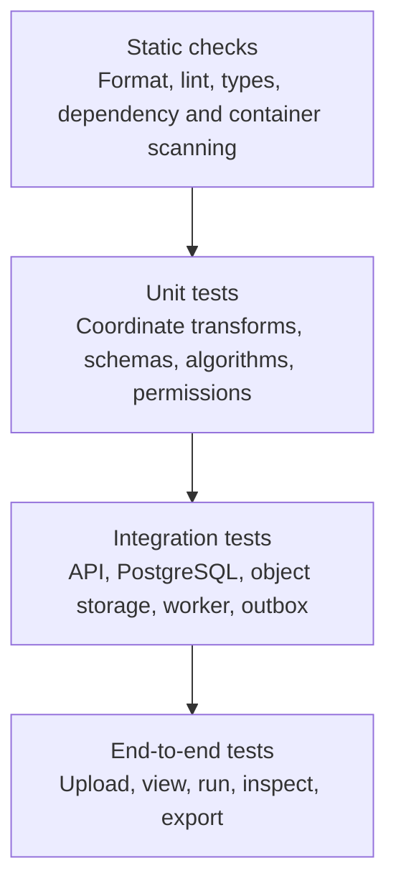

# MRI Lab — Testing Strategy

## 1. Purpose

This document defines the testing approach for MRI Lab, an independent research-oriented neuroimaging SaaS application.

MRI Lab combines a Next.js frontend, a FastAPI backend, PostgreSQL, S3-compatible object storage, a transactional outbox, a Redis-backed Celery worker, and versioned OCI containers that execute scientific image processing. Testing must verify not only that individual functions work, but also that these components behave correctly together under normal operation, invalid input, concurrent requests, partial failures, and duplicate task delivery.

The primary goals are to:

- Protect scientific image-processing correctness, including spatial metadata.
- Prevent cross-project data access at every boundary.
- Verify database integrity, transaction behaviour, and cross-project referential constraints.
- Validate untrusted NIfTI uploads safely and with bounded resource use.
- Ensure reliable, idempotent asynchronous processing.
- Maintain API and frontend contracts through generated types.
- Preserve provenance and reproducibility for every completed run.
- Detect regressions through continuous integration.
- Demonstrate professional software engineering practices.

Testing is scoped to a research-software demonstration. MRI Lab is not a medical device, and no test asserts, implies, or verifies clinical validity.

## 2. Testing Principles

1. Test observable behaviour rather than implementation details.
2. Test critical business rules at the appropriate system boundary.
3. Use small, deterministic, synthetic fixtures for scientific calculations.
4. Use a real PostgreSQL instance for database-specific behaviour.
5. Test authorisation negatively, not only with authorised users.
6. Treat worker execution as potentially duplicated, delayed, or restarted.
7. Test failure recovery as well as successful execution.
8. Assert on spatial metadata (dimensions, spacing, affine, orientation) for every image operation.
9. Keep unit tests fast and integration tests representative.
10. Avoid relying on live cloud resources for ordinary tests.
11. Make failures reproducible and actionable.
12. Keep test data synthetic unless a separate approved test-data process exists.
13. Do not equate high code coverage with scientific correctness.
14. Never commit large raw volumes; generate or fetch small volumes through documented steps.

## 3. Testing Pyramid



### Static checks

Run on every pull request:

- Formatting (`ruff format`, Prettier).
- Linting (`ruff check`, ESLint).
- Type checking (`mypy`, TypeScript).
- Dependency vulnerability scanning (`pip-audit`, `pnpm audit`).
- Container and filesystem vulnerability scanning (Trivy).

### Unit tests

Test isolated behaviour quickly:

- Pydantic request and parameter validation.
- Permission and role decisions.
- Experiment-run and dataset-version state transitions.
- Coordinate transforms (voxel to world and world to voxel).
- NIfTI header parsing and spatial-metadata extraction.
- Image operations (thresholding, smoothing, resampling, masking, segmentation).
- Idempotency-key canonicalisation and request hashing.

### Integration tests

Test component interactions:

- FastAPI with real PostgreSQL.
- Database transactions and constraint enforcement.
- Forward-only SQL migrations.
- Object storage upload, finalisation, and signed URLs.
- Transactional outbox creation and dispatch claiming.
- Celery worker lifecycle, retries, and stale-run recovery.
- Artifact and experiment-manifest persistence.

### End-to-end tests

Test critical workflows through the frontend and backend together. Reserve them for high-value paths; do not use them for every edge case.

## 4. Testing Tools

### Frontend

| Tool                  | Purpose                        |
| --------------------- | ------------------------------ |
| Vitest                | Unit and integration tests     |
| React Testing Library | Component behaviour            |
| Playwright            | Browser-based end-to-end tests |
| TypeScript            | Static type checking           |
| ESLint                | Code-quality checks            |
| Prettier              | Formatting checks              |

### Backend and worker

| Tool                                      | Purpose                                        |
| ----------------------------------------- | ---------------------------------------------- |
| pytest                                    | Test runner                                    |
| pytest-cov                                | Coverage reporting                             |
| HTTPX                                     | API testing against the ASGI app               |
| Pydantic                                  | Request, parameter, and result validation      |
| Psycopg 3                                 | Database integration                           |
| Psycopg-based SQL migration runner        | Migration validation                           |
| NumPy                                     | Array fixtures and expected calculations       |
| NiBabel                                   | Synthetic NIfTI construction and header checks |
| pytest.approx                             | Floating-point tolerance comparisons           |
| Testcontainers or a CI PostgreSQL service | Disposable PostgreSQL integration tests        |

### Security and infrastructure

- Trivy filesystem and container scanning (SARIF output).
- pip-audit and pnpm audit dependency review.
- Docker Compose for local PostgreSQL, Redis, and MinIO.

Use the smallest set of tools that provides the required coverage.

## 5. Test Directory Structure

A possible repository layout, consistent with the module boundaries in `05-architecture.md`:

```text
mri-lab/
├── packages/
│   ├── frontend/
│   │   ├── src/
│   │   │   ├── components/
│   │   │   └── ...
│   │   ├── __tests__/                 # colocated component tests
│   │   └── e2e/                       # Playwright specs
│   └── backend/
│       ├── app/
│       └── tests/
│           ├── unit/                  # transforms, schemas, algorithms
│           ├── integration/           # db, storage, outbox
│           ├── api/                   # endpoint contracts
│           ├── security/              # cross-project negative tests
│           └── fixtures/
│               └── nifti/             # synthetic fixtures and generators
├── workers/
│   └── tests/
│       ├── unit/
│       ├── integration/
│       └── fixtures/
└── tests/
    └── e2e/
```

Shared synthetic-NIfTI builders live in one importable module so the API, worker, and scientific tests generate identical fixtures rather than duplicated copies.

## 6. Scientific Correctness Tests

Scientific calculations need explicit mathematical expectations. Tests must not merely check that a result exists or that a function returns a number. Every image operation must be checked for both numerical output and preserved spatial metadata.

### 6.1 Required spatial-metadata assertions

For any operation that does not intentionally change the sampling grid, assert that the output preserves:

- Array shape (dimensions).
- Voxel spacing (`pixdim`).
- Affine transform (voxel-to-world).
- Orientation codes and the declared coordinate convention (for example RAS+ versus LAS).
- Data type, unless the operation documents a type change.

For resampling, assert that the output does not preserve the input grid and that the header changes are exactly the documented ones.

### 6.2 Coordinate-transform unit tests

Coordinate transforms are the most error-prone part of any neuroimaging platform. Test them directly and in isolation.

The core operations are:

- Voxel index (i, j, k) to world millimetre coordinates: `world = affine @ [i, j, k, 1]`.
- World millimetre to voxel index: `voxel = inv(affine) @ [x, y, z, 1]`.
- Orientation mapping and axis-flip handling between conventions.

Required cases:

| Case                                 | Expectation                                                       |
| ------------------------------------ | ----------------------------------------------------------------- |
| Identity affine, origin offset       | Known voxel maps to a computable world coordinate                 |
| Negative determinant (flipped axis)  | Orientation reflects a left-handed (for example LAS) volume       |
| Anisotropic spacing                  | Millimetre distances scale per axis independently                 |
| Rotated affine (oblique acquisition) | Round-trip voxel → world → voxel recovers the original indices    |
| Non-invertible affine                | Validation rejects the volume before any transform is relied upon |
| Known landmark (for example centre)  | Maps to the expected world coordinate within tolerance            |

Use `pytest.approx` with a documented tolerance (for example `abs=1e-6` mm for round-trips on float64 affines) rather than exact binary equality. Assert that an orientation readout for a linear affine matches the NiBabel orientation string.

### 6.3 Image-operation expected outputs

Use tiny arrays with hand-computed expectations.

Example fixture:

```python
import numpy as np
import nibabel as nib

data = np.arange(27, dtype=np.float32).reshape((3, 3, 3))
affine = np.diag([2.0, 3.0, 4.0, 1.0])
affine[:3, 3] = [-10.0, -20.0, -30.0]
img = nib.Nifti1Image(data, affine)
```

Expected behaviour:

| Operation                | Expected output                                                    |
| ------------------------ | ------------------------------------------------------------------ |
| Threshold at `> 13`      | Binary mask keeping voxels 14..26; values normalised to 0/1        |
| Gaussian smoothing FWHM  | White-matter-ish interior value moves toward the local mean        |
| Resample to 1 mm spacing | New shape scaled by `2, 3, 4`; affine updates; values interpolated |
| Masking with region mask | Unmasked voxels set to zero; masked voxels unchanged               |
| Region volume statistics | Millimetre-cubed volume equals voxel count times voxel volume      |

For smoothing, assert against an independently computed reference (for example the analytic result on a known impulse) within a documented tolerance, and assert the FWHM is expressed in millimetres and converted using voxel spacing, not voxel counts.

### 6.4 Required numerical test cases

- Constant-valued volumes.
- Positive and negative intensities.
- Single-voxel and single-slice volumes.
- Volumes containing non-finite (`NaN`, `inf`) values, and the documented handling of them.
- Integer volumes where arithmetic could overflow the input type.
- Empty arrays and incorrect ranks.
- Unsupported dtypes.
- Header metadata that does not match the array shape.
- Thresholds outside the data range.
- Kernels larger than the volume.
- Extreme or invalid target spacing for resampling.
- Mask shape or affine that does not match the source volume.

The accepted behaviour must be consistent between the numerical implementation, the API contract, and the UI.

### 6.5 Scientific invariants

For every successful operation:

- Output affine is finite and, where the grid is unchanged, identical to the input.
- Output shape and spacing are internally consistent with the affine.
- Region volumes are non-negative and expressed with units.
- Binary masks contain only the documented label values.
- No operation mutates the source volume in place.

These invariant checks complement, but do not replace, comparison against known expected results.

## 7. Synthetic NIfTI Fixtures

Create deterministic synthetic NIfTI datasets for testing. Never commit large raw volumes, and do not use real participant scans merely because they are convenient.

Recommended fixtures, all generated programmatically:

1. A fixed small volume (for example 4×4×4) with exact integer values for thresholding and statistics.
2. A volume with known coordinate landmarks, such that a specific voxel index has a hand-computable world coordinate.
3. An anisotropic-spacing volume (for example 1×1×3 mm) for spacing-preservation tests.
4. An obliquely rotated affine for round-trip transform tests.
5. A volume in a non-RAS orientation to test convention handling and explicit labelling.
6. A 4D volume (multiple volumes) to test volume-index selection.
7. A `.nii.gz` compressed variant to test decompression bounds.
8. A volume containing non-finite samples.
9. A malformed or truncated header.
10. A decompression-bomb-shaped gzip file.
11. A volume exceeding configured maximum dimensions or decompressed size.

Fixtures are produced by a shared generator module:

```python
def make_nifti(shape=(4, 4, 4), spacing=(1.0, 1.0, 1.0), orientation="RAS"):
    ...
```

Rules:

- Use a fixed random seed for any randomised fixture, or avoid randomness entirely.
- Keep `.nii` and `.nii.gz` fixtures tiny; store fixtures as code (generators) rather than committed binaries where practical.
- When a binary fixture is unavoidable, keep it minimal and store a checksum alongside it.
- Refer to the field guide for licensing and citation of public samples; if a public sample is used at all, fetch it through a documented, optional step and record its licence.
- Every fixture that asserts a landmark must document the expected world coordinate next to its definition.

## 8. API Tests

Test endpoint behaviour using FastAPI's ASGI test integration with HTTPX.

### Project endpoints

- Valid project creation returns `201`.
- Missing or blank names are rejected.
- Unauthorised creation is rejected.
- Archiving preserves data and switches the project to read-only.
- The last owner cannot be removed or demoted.
- Pagination returns deterministic results and rejects invalid cursors safely.

### Dataset endpoints

- Dataset creation requires a valid parent project.
- A project the caller is not a member of cannot be referenced.
- Unsupported extensions and content/extension mismatches are rejected.
- A dataset cannot become `ready` before validation succeeds.
- Upload finalisation is idempotent and yields at most one dataset version.
- A checksum mismatch rejects the upload.

### Pipeline and run endpoints

- Non-ready dataset versions cannot be used as run inputs.
- Invalid parameters are rejected against the pipeline version's schema.
- Duplicate submission with the same idempotency key does not create duplicate runs.
- Reusing an idempotency key with a different request hash returns `409`.
- A run's status reflects persisted state in PostgreSQL.
- Artifacts are unavailable before a run has `succeeded`.
- Failed runs expose a safe failure summary and never internal exceptions.
- Run provenance (pipeline version, image digest, input checksums, parameters) is returned correctly.

### Error responses

Verify that errors consistently include:

- A stable error code.
- A safe human-readable message.
- Field details where applicable.
- A request ID.

Do not assert on incidental internal exception wording, and confirm that responses do not leak internal paths, stack traces, or object keys.

## 9. Multi-Tenancy and Authorisation Tests

Project isolation is a critical security requirement. The architecture treats object-key possession as non-authorisation, and the tests must prove it.

Create at least two projects with separate owners, members, datasets, dataset versions, pipelines, runs, artifacts, and annotations.

Test that a user from Project A cannot read or modify Project B's resources by:

- Changing the project ID in the URL.
- Substituting another project's dataset ID.
- Substituting another project's dataset-version ID.
- Substituting another project's pipeline or pipeline-version ID.
- Substituting another project's run ID.
- Substituting another project's artifact or annotation ID.
- Reusing an identifier obtained from a different context.
- Submitting a dataset version from another project in a run request.
- Attempting to finalise another project's upload session.
- Requesting a signed URL for another project's object by guessing or reusing an object key.

Test all role boundaries:

| Role      | Expected boundary                                                |
| --------- | ---------------------------------------------------------------- |
| `owner`   | May perform permitted administrative and workflow operations     |
| `editor`  | May create and modify datasets, pipelines, runs, and annotations |
| `viewer`  | May read but cannot modify data or submit runs                   |
| anonymous | Cannot access any protected resource                             |
| revoked   | A removed member cannot continue using previously granted access |

### Database-level integrity

Where composite project foreign keys are used (section 23 of `06-data-model.md`), test that PostgreSQL rejects cross-project relationships even when application-level validation is bypassed and a row is inserted directly.

### Query scoping

Verify that project filtering is applied before pagination and aggregation. A correct permission check on a parent resource does not automatically make every child query safe.

Every cross-project attempt must be denied without revealing whether the target resource exists.

## 10. Database and Transaction Tests

Use a real PostgreSQL instance (a CI service or testcontainers) for tests that depend on PostgreSQL behaviour.

Test:

- Fresh schema creation.
- Forward-only SQL migration execution.
- Unique `project_members` per project and user.
- Valid `projects.visibility` and role values.
- Foreign key enforcement and `RESTRICT` behaviour.
- Composite project constraints across `datasets`, `upload_sessions`, `pipelines`, and `annotations`.
- Valid `dataset_versions` and `experiment_runs` states.
- Required `finished_at` on terminal run states.
- Checksum and object-key uniqueness for `file_assets` and `artifacts`.
- Explicit `annotations.coordinate_space` presence.
- Transaction rollback.
- Concurrent updates and run claiming.
- Idempotency-key uniqueness and mismatched `request_hash` rejection.
- Transactional `outbox_events` creation alongside run creation.
- Artifact and manifest persistence before a run is marked successful.
- Last-owner protection.
- Archival behaviour.

### Transactional run creation

A run submission must not produce a committed run without the corresponding durable dispatch event.

Test the transaction boundary:

1. Begin the transaction.
2. Create the `experiment_runs` row.
3. Create its `outbox_events` row.
4. Commit both together.
5. Verify both records exist.

If either operation fails, verify that neither record is left partially committed.

### Migration tests

Test migrations from:

- An empty database.
- The previous released schema, when applicable.
- A representative database containing existing rows.

Verify the expand-and-contract discipline: no migration drops a shape that the concurrently deployed code still reads, and every migration is additive and applied before the API or worker starts.

## 11. Background Worker Tests

Background jobs are distributed operations. Assume messages may be delayed, delivered more than once, or processed after a worker restart.

### Run lifecycle

Test:

- `queued` transitions to `running`.
- `running` transitions to `succeeded` only after artifacts and manifest are persisted.
- Expected execution errors transition to `failed` or trigger an explicitly permitted retry.
- Queued runs can be cancelled.
- Running runs follow the documented cancellation policy.
- Terminal runs cannot be silently reopened.
- A worker loads the persisted run state and checks it permits execution before claiming.

### Idempotent execution and duplicate delivery

Deliver the same task more than once and verify that:

- Only one canonical result is committed.
- Repeated execution does not corrupt or duplicate artifacts.
- A duplicate message cannot overwrite a `succeeded` result with a failure or vice versa.
- A duplicate message cannot reopen a `cancelled` run.
- Duplicate outbox dispatch is safe.
- State transitions remain valid on every delivery.
- Resource limits prevent a duplicate from running expensive computation twice when the first succeeded.

### Reproducibility and dispatch tests

- A run record and its outbox event commit atomically; a rollback leaves neither.
- The dispatcher claims rows with `FOR UPDATE SKIP LOCKED` so two dispatchers do not process the same event.
- The dispatcher marks an event `dispatched` only after successful publication.
- A dispatcher crash leaves uncommitted work retryable.
- Redis unavailability delays dispatch but never loses an accepted run.
- A worker that discovers a run already completed exits without changing its result.

### Failure and recovery

Simulate:

- Worker termination during execution.
- A run left `running` after a crash (stale lease).
- Object storage temporarily unavailable.
- Database connection loss.
- Invalid run input.
- Outbox dispatch failure.
- A run exceeding its lease or execution timeout.
- Exhausted retry attempts.

Verify that failures are visible in PostgreSQL, that retry behaviour is bounded and classified (transient versus permanent), and that no partial result is marked successful.

### Avoid false confidence from eager mode

Celery eager mode is useful for some unit tests, but it does not reproduce real broker and worker-process behaviour. Use a real test broker or a representative integration environment for critical delivery, retry, and worker-lifecycle tests.

## 12. Object Storage Tests

Test storage behaviour through the `ObjectStorage` abstraction, replaceable with a local MinIO instance or an in-memory test implementation.

Verify:

- Object keys are generated by the server and are not client-supplied.
- Bucket access is private by default.
- Upload authorisations and signed URLs expire.
- Finalisation confirms the object exists, matches the declared size, and matches the checksum.
- The server computes a SHA-256 checksum when the client did not supply one.
- Failed validation does not mark a dataset version `ready`.
- Abandoned upload sessions and unreferenced objects can be cleaned up safely, with a delay.
- Temporary URLs and credentials are never logged.
- An object from another dataset cannot be attached by changing a client-supplied key.
- Retrieval detects a checksum mismatch.

Use provider-specific integration tests for signed URLs where practical, and confirm that a signed URL is scoped to a single object and grants no listing or overwrite rights.

## 13. Frontend Component Tests

Use Vitest and React Testing Library to test user-visible behaviour. Place tests in colocated `__tests__` directories next to the code they exercise.

Test components such as:

- Sign-in form.
- Project creation and membership controls.
- Dataset upload form and progress.
- Dataset validation and metadata panel.
- Viewer multiplanar panels and linked crosshairs.
- Window/level, zoom, pan, and colour-map controls.
- Coordinate readout (voxel, world, coordinate space).
- Atlas overlay toggle and region label readout.
- Pipeline parameter form.
- Run submission control and status indicator.
- Artifact list and download controls.
- Comparison view and export controls.
- Error, empty, and disabled states.

Verify:

- Inputs have accessible labels.
- Keyboard navigation works for interactive controls.
- Loading, empty, partial, disabled, and permission-denied states render correctly.
- Validation errors are understandable and actionable.
- Failed API requests do not display fabricated success.
- Viewers do not see enabled write controls.
- Data refreshes correctly after mutations.
- Long-running runs show current status and progress.

Do not test implementation details such as internal component state when the same behaviour can be tested through the rendered interface.

## 14. Visualisation Tests

The MRI viewer and comparison views require additional correctness checks beyond "it rendered".

Test that:

- The orientation labels and coordinate convention shown to the user match the volume's affine.
- The voxel-to-world readout matches the back-end coordinate transform for a known landmark.
- Slice indices map to the correct anatomical axis for axial, coronal, and sagittal views.
- Anisotropic spacing is reflected in aspect ratio and coordinates.
- Window/level, zoom, pan, and colour-map changes are display-only and never alter stored data.
- Display transforms are never recorded as run inputs.
- Region labels are always shown with the atlas name and coordinate space.
- An incompatible atlas produces a clear explanation rather than a misleading overlay.
- Empty, validating, out-of-bounds, and retrieval-error states are meaningful.
- Large volumes respect documented rendering and downsample limits, and downsampling does not alter persisted analysis results.
- Chart and viewer labels and alternative textual summaries are available.

A viewer that renders without throwing an exception is not necessarily scientifically correct.

## 15. End-to-End Tests

Use Playwright with Chromium for a small number of critical user workflows, matching the CI `e2e` job.

### Workflow A: Upload, view, run, inspect, export

1. Sign in using the supported test authentication configuration.
2. Create or select an authorised project.
3. Register a synthetic NIfTI dataset.
4. Upload the file and finalise the upload.
5. Wait for validation to reach `ready`.
6. Open the dataset detail page and verify dimensions, spacing, and orientation.
7. Open the viewer and navigate axial, coronal, and sagittal slices with linked crosshairs.
8. Verify the coordinate readout for a known landmark.
9. Submit a processing run with deterministic parameters.
10. Wait for the run to reach `succeeded`.
11. Open the result view and verify the expected numerical output and provenance.
12. Export the experiment manifest and verify its input references.

### Workflow B: Permission boundaries

1. Sign in as a viewer.
2. Open a project and dataset.
3. Verify that read access works.
4. Verify that write controls are unavailable or disabled.
5. Attempt the corresponding protected API request directly.
6. Verify that the backend rejects it.

Hiding a button is not sufficient proof of authorisation.

### Workflow C: Failure handling

1. Attempt to upload an invalid or malformed NIfTI file.
2. Verify that validation fails.
3. Verify that the dataset never becomes `ready`.
4. Verify that the UI explains the failure safely.
5. Verify that no run can be submitted for the invalid dataset.

Use deterministic fixture data so expected results are known. End-to-end tests run on pull requests when practical and must run before a release.

## 16. Contract and Type Consistency Tests

The API is defined by FastAPI and Pydantic.

Where practical:

- Generate an OpenAPI specification in CI.
- Generate TypeScript client types from OpenAPI.
- Check generated files for unexpected changes (fail on drift unless committed).
- Validate representative API responses against the contract.
- Ensure frontend and backend agree on status values (`queued`, `running`, `succeeded`, `failed`, `cancelled`) and error codes.
- Ensure dataset-version and run-lifecycle states match the data model.

Avoid maintaining duplicated type definitions when automated generation is reliable and easier to maintain.

## 17. Performance and Resource Tests

Performance testing focuses on the application's likely bottlenecks.

Test:

- Dataset-list and run-list queries at representative sizes.
- Pagination behaviour.
- Concurrent upload finalisations and run submissions.
- Worker processing time for supported volume sizes.
- Memory use while loading and validating NIfTI headers and arrays.
- Bounded parsing: malformed and oversized headers are rejected without exhausting memory.
- Viewer rendering with maximum supported slice and volume counts.
- Database connection-pool behaviour.
- Recovery after a temporary dependency outage.

Define realistic limits for the MVP before claiming support for large volumes. Do not run expensive benchmarks on every pull request; use targeted smoke tests in CI and scheduled or release-oriented load tests where justified.

## 18. Security Testing

Include checks for:

- Cross-project access (broken object-level authorisation).
- SQL injection resistance; all SQL values must be parameterised.
- Unsafe NIfTI header parsing and malformed input.
- Oversized uploads and decompression bombs.
- Malformed JSON and metadata.
- Excessive resource consumption (CPU, memory, disk, runtime).
- Secret leakage in logs, errors, audit events, and manifests.
- Signed URL leakage and expiry.
- Object-key possession being treated as authorisation.
- Worker isolation: no default access to secrets, the database, or other users' files.
- Network egress restrictions and blocked cloud metadata endpoints.
- Unauthorised role and membership changes.
- Unsafe error responses that leak internal details.
- Dependency vulnerabilities (`pip-audit`, `pnpm audit`).
- Container and filesystem vulnerabilities (Trivy).
- Public exposure of private object storage.
- Insecure default configuration.

Dynamic SQL identifiers, when unavoidable, must be selected from trusted allowlists rather than interpolated from user input. Deletion of storage objects must never occur while a live database row still references them.

## 19. Continuous Integration Gates

Every pull request must pass the checks relevant to the changed code. The authoritative gate is the GitHub Actions workflow in `.github/workflows/ci.yml`.

### Backend job

Working directory `packages/backend`, against a PostgreSQL 18 service, Python 3.14 via `uv`:

| Step             | Command                                                  |
| ---------------- | -------------------------------------------------------- |
| Install          | `uv sync --all-groups`                                   |
| Format check     | `ruff format --check .`                                  |
| Lint             | `ruff check .`                                           |
| Type check       | `python -m mypy .`                                       |
| Migrations       | `python -m app.db.migrations upgrade`                    |
| Tests            | `pytest -q --cov=app --cov-report=term-missing`          |
| Dependency audit | `pip-audit --desc --format=json --output=pip-audit.json` |

The pip-audit step runs with `|| true` and uploads its JSON report as an artifact, so findings are visible without blocking a merge; security findings must still be reviewed and triaged.

### Frontend job

Working directory `packages/frontend`, pnpm 12, Node from `.nvmrc`:

| Step             | Command                                     |
| ---------------- | ------------------------------------------- |
| Install          | `pnpm install --frozen-lockfile`            |
| Lint + format    | `pnpm lint && pnpm format:check`            |
| Type check       | `pnpm typecheck`                            |
| Unit tests       | `pnpm test`                                 |
| Build            | `pnpm build`                                |
| Dependency audit | `pnpm audit --json --output=npm-audit.json` |

The pnpm audit step also runs with `|| true` and uploads an artifact for review.

### End-to-end job

Runs after the frontend job:

| Step                | Command                                             |
| ------------------- | --------------------------------------------------- |
| Install             | `pnpm install --frozen-lockfile`                    |
| Playwright browsers | `pnpm exec playwright install --with-deps chromium` |
| Smoke tests         | `pnpm test:e2e`                                     |

### Security job

- Trivy filesystem scan (`scan-type: fs`, `severity: CRITICAL,HIGH,MEDIUM`, `ignore-unfixed: true`).
- SARIF output uploaded to GitHub Security via `upload-sarif`.
- Grant `security-events: write` and `contents: read` only.

### Release build

On pushes to `master`, a Tauri desktop build matrix runs only after the backend, frontend, e2e, and security jobs succeed. A Tauri build failure blocks the release but is not a per-pull-request gate.

### Local feedback

The Husky pre-commit hook uses lint-staged to run Ruff on staged Python files and ESLint/Prettier on staged frontend files. These hooks provide fast feedback and do not replace any required CI gate.

Do not weaken critical security or scientific-correctness gates solely to make a pipeline green.

## 20. Test Data and Environment Management

Use synthetic test data exclusively for ordinary development and CI.

Requirements:

- Keep fixtures small and deterministic.
- Generate larger volumes only for resource-limit tests, and delete them afterward.
- Never commit large raw volumes; keep fixtures as generators where practical.
- Keep secrets out of fixture files and out of the repository.
- Use isolated test databases created per test session or per test.
- Clean up temporary storage objects and upload sessions.
- Avoid shared mutable fixtures across tests.
- Ensure parallel tests cannot interfere with one another (for example through unique object keys and isolated schemas).
- Keep local-development authentication isolated from production authentication.

If real research data is ever introduced, establish an explicit approval, access, retention, and anonymisation process first, and record the dataset licence and citation requirements.

## 21. Coverage and Quality Targets

Code coverage is a diagnostic, not the primary success criterion. Do not set a single line-coverage percentage as a release gate. CI reports coverage with `pytest --cov` so that trends and untested areas are visible.

Prioritise instead:

- High coverage of coordinate-transform and numerical edge cases.
- Complete coverage of critical role and project-isolation scenarios.
- Explicit tests for every supported run and dataset-version state transition.
- Explicit tests for worker idempotency and duplicate delivery.
- End-to-end coverage of the primary upload-to-export workflow.

Do not chase coverage by testing trivial getters or writing assertions that provide little confidence. Critical security boundaries and scientific algorithms deserve stronger targeted tests than their raw line coverage might suggest.

## 22. Defect Handling

When a defect is found:

1. Reproduce the failure.
2. Determine the affected boundary.
3. Add a regression test.
4. Fix the underlying cause.
5. Run the relevant test suite.
6. Review whether other endpoints or workflows share the same defect.
7. Document the impact if it affects scientific results, security, provenance, or persisted data.

For defects that could have altered persisted scientific results, consider whether existing artifacts or manifests need to be invalidated, recomputed, or marked with an affected algorithm or pipeline version, and whether orientation or coordinate metadata was affected.

## 23. Definition of Done

The testing strategy is satisfied for a feature or release when:

1. Expected behaviour is tested at the appropriate pyramid level.
2. Invalid and malformed NIfTI inputs are handled safely.
3. Authorisation is enforced server-side and cross-project negative tests pass.
4. Relevant database constraints, transactions, and migrations are tested.
5. Every image operation has known expected outputs and preserved-spatial-metadata assertions.
6. Coordinate-transform round-trips and known landmarks are verified within tolerance.
7. Worker idempotency, duplicate delivery, retry, cancellation, and stale-run recovery are covered.
8. Reproducibility is verified: an identical configuration resolves to the same inputs, container digest, and environment, with numerical equivalence tolerated where bitwise identity is unrealistic.
9. Object-storage privacy, expiry, checksums, and cleanup are tested.
10. Frontend loading, success, empty, error, partial, disabled, and permission-denied states are implemented and tested.
11. API and frontend contracts are checked for drift.
12. The required GitHub Actions gates pass, including backend lint, format, type check, migrations, tests with coverage, and pip-audit; frontend lint, format, type check, tests, build, and pnpm audit; Playwright end-to-end tests; and the Trivy SARIF scan.
13. No sensitive test data, large raw volumes, or credentials are committed.
14. Documentation and API contracts are updated.
15. The feature introduces no unsupported medical or diagnostic claims.
